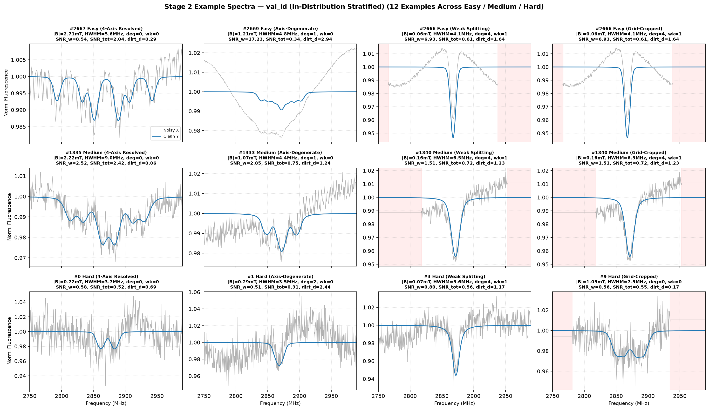
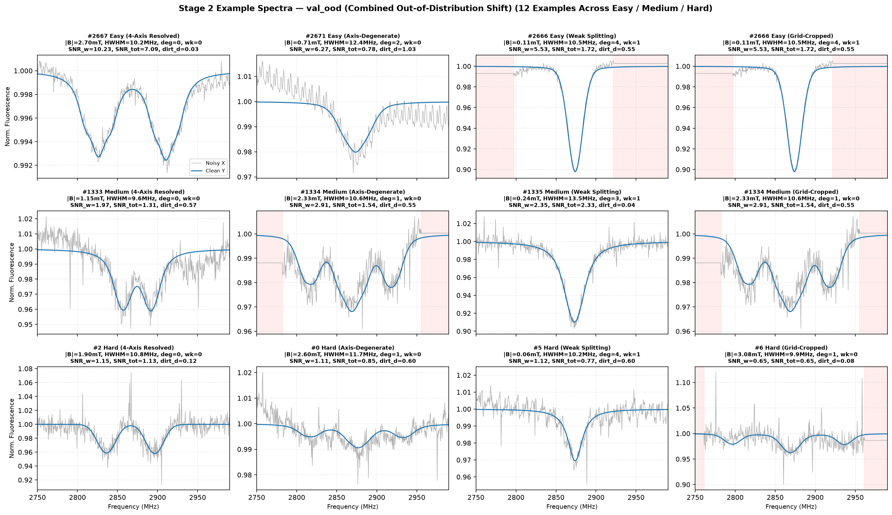
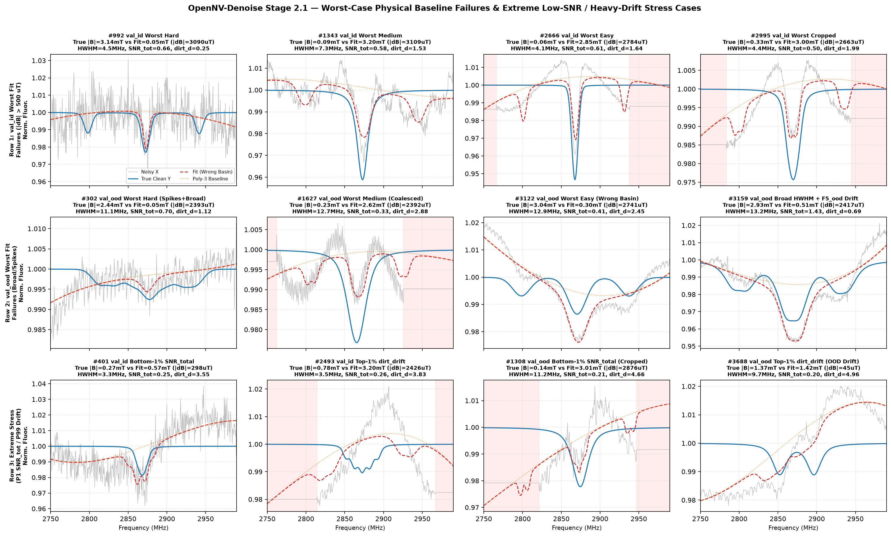
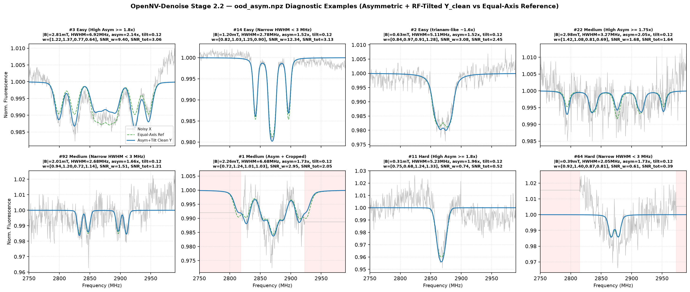

# OpenNV-Denoise Stage 2 / 2.1 / 2.2 Data Validation & Reference Estimator Report (`stage2-data-v3`)

This report documents the empirical distributions, disjoint support verification, numerical consistency checks, dry-run twin audit, real experimental data import status, deep `trianam` spectral anatomy comparison, Stage 2.2 Sim-to-Real upgrade (`train_sim2real` & `ood_asym.npz`), worst-case failure diagnostics, and expanded reference estimator benchmarks for **OpenNV-Denoise Stage 2.2 (`stage2-data-v3`)**.

> [!IMPORTANT]
> **Locked Test-Set Integrity**: All tables, figures, and statistics in this report are built **exclusively** from `train_snapshot`, `train_sim2real`, `val_id`, `val_id_natural`, `val_ood`, the 9 single-factor `ood_*` validation sets (including `ood_high_field` and `ood_asym`), and the deleted dry-run twins (`twin_test_id`, `twin_test_ood`). The locked test files (`test_id.npz`, `test_ood.npz`) were never opened or parsed (`data_read = 0` in [`data/synthetic/test_access.log`](../data/synthetic/test_access.log)).

---

## 1. Part 0a Clean-Up: Frozen Baseline `poly_degree` & Field-Bound Audit

### 1.1 Default Polynomial Baseline Degree (`poly_degree = 3`)
Inspection of `git show baseline-frozen:src/baseline.py` confirms that the default polynomial baseline degree of `fit_physical_odmr` at tag `baseline-frozen` (`e9194ad`) is:
```python
poly_degree: int = 3
```
All rows in `README.md` Table 1 and Table 2 have been explicitly labelled with their exact baseline parameterization:
- `naive (deg-1, frozen)` and `naive (deg-1, fixed)`: linear baseline (`deg-1`).
- `physical, plain (deg-2)`: quadratic Legendre baseline (`poly_degree=2`).
- `physical, plain (deg-3: cubic drift match)`: cubic Legendre baseline (`poly_degree=3`, frozen default).
- `physical, with_prior (deg-3, lam=2.5e-4)`: cubic Legendre baseline (`poly_degree=3`).
- `physical, informed_unknown_freq (deg-2, 45-65Hz)`: quadratic Legendre baseline (`poly_degree=2`) + scanned fundamental sinusoid.
- `physical, informed_harmonics (deg-2, 1-3f)`: quadratic Legendre baseline (`poly_degree=2`) + 1f/2f/3f harmonic sinusoids.
- `physical, informed (deg-3, exact 50Hz UB)`: cubic Legendre baseline (`poly_degree=3`) + exact 50/60 Hz fundamental sinusoid.
- `physical, oracle (0-poly: known drift only)` and `physical, oracle (0-poly: true drift + hum)`: `0` fitted polynomial parameters (true baseline subtracted directly).

### 1.2 Programmatic Audit of Frozen `src/baseline.py` Radial Field Bounds (Task 2.1)
Programmatic inspection of frozen [`src/baseline.py`](../src/baseline.py) confirms that `fit_physical_odmr` is radially confined to $[0.05, 3.20]\text{ mT}$ (`B_MAG_MIN_MT = 0.05`, `B_MAG_MAX_MT = 3.20`) across four internal stages:
1. **`_stage_a_coarse_screen` ([`src/baseline.py#L422-L433`](../src/baseline.py#L422-L433))**: Coarse screening evaluates `uniform_mags = np.linspace(0.15, 3.05, 11)` and clips adaptive peak-derived magnitudes via `np.clip(m_est + delta, 0.08, 3.18)`.
2. **`_mirror_fold_and_analytic_candidates` ([`src/baseline.py#L494`](../src/baseline.py#L494))**: Analytic dip-pair candidates are rejected unless `B_MAG_MIN_MT <= b_mag <= B_MAG_MAX_MT` (`0.05 <= b_mag <= 3.20 mT`).
3. **`_run_varproj_pipeline` ([`src/baseline.py#L774-L819`](../src/baseline.py#L774-L819))**: Continuous TRF optimization uses Cartesian box bounds `lb[:3] = [-3.30, -3.30, -3.30]\text{ mT}`, `ub[:3] = [3.30, 3.30, 3.30]\text{ mT}` combined with a soft radial penalty `rad_pen = 2.0 * max(0.0, b_norm - 3.20) + 2.0 * max(0.0, 0.05 - b_norm)`.
4. **Validity & Out-of-Range Classification ([`src/baseline.py#L868-L881`](../src/baseline.py#L868-L881))**: `in_range = (B_MAG_MIN_MT - 1e-4 <= b_mag <= B_MAG_MAX_MT + 1e-4) and not window_trunc`; any fit with $|\mathbf{B}| > 3.2001\text{ mT}$ is flagged `out_of_range = True, success = False, status = "out_of_range"`.

Consequently, all primary ID/OOD benchmark splits (`train`, `train_snapshot`, `val_id`, `val_id_natural`, `val_ood`, `test_id`, `test_ood`) keep $|\mathbf{B}| \in [0.05, 3.20]\text{ mT}$ for 100% fair comparison against frozen `baseline.py`, while the high-field in-window regime $|\mathbf{B}| \in [3.25, 4.60]\text{ mT}$ (covering `trianam_small_field_1..4`) is evaluated via the dedicated diagnostic split `ood_high_field.npz`.

---

## 2. Generator Throughput & Split Manifest Summary (Part 4 & Stage 2.1)

Measured on the canonical 512-point grid (including 30%–100% PCHIP resampling for perturbed grids):
- **Standard `train` Single-Process Throughput (`n_workers = 1`, $N = 2000$)**: **`408.0 spectra/s`** (`4.902 s` for 2,000 samples; **`464.2 spectra/s`** on 1,000 samples); **Multi-Worker (`n_workers = 4`)**: **`1,100.0 – 1,186.0 spectra/s`**.
- **Stage 2.2 `train_sim2real` On-the-Fly Throughput (`get_stage3_sim2real_train_config()`)**:
  - **Single-Process (`n_workers = 1`, $N = 2000$)**: **`466.1 spectra/s`** (`4.291 s` for 2,000 samples).
  - **Multi-Worker (`n_workers = 4`, $N = 8000$)**: **`1,031.7 spectra/s`** (`7.755 s` for 8,000 samples).

### Generated Splits & SHA256 Checksums (`data/synthetic/manifest.json`)
| Split Name | $N$ | Master Seed | Regime Counts (Hard / Med / Easy) | Regime Proportions | $|\mathbf{B}|$ Range (mT) | Raw-Byte SHA256 |
| :--- | :---: | :---: | :---: | :---: | :---: | :--- |
| `train_snapshot` | `20,000` | `20260102` | `5855 / 3727 / 10418` | `29.3% / 18.6% / 52.1%` (Natural) | `[0.05, 3.20]` | `37761c3d40349ae3...` |
| `val_id` | `4,000` | `20260201` | `1333 / 1333 / 1334` | `33.3% / 33.3% / 33.4%` (Stratified) | `[0.05, 3.20]` | `294efabc236b3623...` |
| `val_id_natural` | `1,500` | `20260203` | `430 / 300 / 770` | `28.7% / 20.0% / 51.3%` (Natural) | `[0.05, 3.20]` | `20c84af464043f34...` |
| `val_ood` | `4,000` | `20260202` | `1333 / 1333 / 1334` | `33.3% / 33.3% / 33.4%` (Stratified) | `[0.05, 3.20]` | `014df8d74cab853b...` |
| `ood_hwhm` | `1,000` | `20260301` | `297 / 187 / 516` | `29.7% / 18.7% / 51.6%` (Natural) | `[0.05, 3.20]` | `643cb17ffd93f0d4...` |
| `ood_contrast` | `1,000` | `20260302` | `300 / 197 / 503` | `30.0% / 19.7% / 50.3%` (Natural) | `[0.05, 3.20]` | `9396e1f3efc8b3ee...` |
| `ood_d0` | `1,000` | `20260303` | `304 / 212 / 484` | `30.4% / 21.2% / 48.4%` (Natural) | `[0.05, 3.20]` | `501e98151a698d6e...` |
| `ood_noise` | `1,000` | `20260304` | `310 / 183 / 507` | `31.0% / 18.3% / 50.7%` (Natural) | `[0.05, 3.20]` | `9c6bbd457165dca0...` |
| `ood_drift` | `1,000` | `20260305` | `288 / 194 / 518` | `28.8% / 19.4% / 51.8%` (Natural) | `[0.05, 3.20]` | `c75b7c630e7ffe97...` |
| `ood_hum` | `1,000` | `20260306` | `279 / 184 / 537` | `27.9% / 18.4% / 53.7%` (Natural) | `[0.05, 3.20]` | `9b57ed282f1a5320...` |
| `ood_grid` | `1,000` | `20260307` | `266 / 193 / 541` | `26.6% / 19.3% / 54.1%` (Natural) | `[0.05, 3.20]` | `f7998fbb6d7da6fd...` |
| `ood_high_field` | `1,000` | `20260308` | `317 / 186 / 497` | `31.7% / 18.6% / 49.7%` (Natural) | **`[3.25, 4.60]`** | `432b6e668a4fefe4...` |
| `ood_asym` | `1,000` | `20260309` | `288 / 176 / 536` | `28.8% / 17.6% / 53.6%` (Natural) | `[0.05, 3.20]` | `a5498d1b570240ac...` |
| `test_id` (LOCKED) | `4,000` | `20260901` | `1333 / 1333 / 1334` | `33.3% / 33.3% / 33.4%` (Stratified) | `[0.05, 3.20]` | `819e007a1a3fbc45...` |
| `test_ood` (LOCKED) | `4,000` | `20260902` | `1333 / 1333 / 1334` | `33.3% / 33.3% / 33.4%` (Stratified) | `[0.05, 3.20]` | `fcdce8033fb0d04c...` |
| `val_baseline_ref` | `6,800` fits | Ref Cache | Per-spectrum baseline predictions/errors | Saved for Stage 3 paired Wilcoxon/bootstrap | — | `906b78e739b17e74...` |
| `ood_asym_baseline_ref` | `200` fits | Ref Cache | Per-spectrum `ood_asym` baseline results | Saved for Stage 3 asymmetry evaluation | — | `db7d7ac1ea01bcd4...` |

*(Theoretical natural log-uniform proportions on $[0.5, 20.0]$: Hard $29.79\%$, Medium $18.79\%$, Easy $51.42\%$).*

---

## 3. Numerical Consistency & Dry-Run Twin Verification (Part 6)

Every non-test split and the deleted dry-run twins (`twin_test_id` seed `999901`, `twin_test_ood` seed `999902`) were verified across regenerated samples:

| Split Name | NaN / Inf Count | Max `float64` Component Identity Error ($<10^{-12}$) | Max `float32` Component Identity Error ($<10^{-6}$) | Max $\|Y_{\text{clean}} - \text{simulate\_clean\_odmr}\|$ ($<10^{-10}$) | Max $\|Y_{\text{splittings}} - \Delta f_{\text{eigh}}\|$ (MHz) | `b_mag_from_splittings(order=2)` vs. $Y_{b\_\text{mag}}$ RMS ($\mu\text{T}$) |
| :--- | :---: | :---: | :---: | :---: | :---: | :---: |
| `train_snapshot` | `0` | `0.00e+00` | `0.00e+00` | `2.55e-15` | `7.06e-06` | `0.00014` |
| `val_id` | `0` | `0.00e+00` | `0.00e+00` | `3.66e-15` | `6.82e-06` | `0.00013` |
| `val_id_natural` | `0` | `0.00e+00` | `0.00e+00` | `1.78e-15` | `7.60e-06` | `0.00013` |
| `val_ood` | `0` | `0.00e+00` | `0.00e+00` | `3.11e-15` | `7.60e-06` | `0.00013` |
| `ood_hwhm` | `0` | `0.00e+00` | `0.00e+00` | `1.67e-15` | `7.46e-06` | `0.00014` |
| `ood_contrast` | `0` | `0.00e+00` | `0.00e+00` | `6.55e-15` | `7.32e-06` | `0.00014` |
| `ood_d0` | `0` | `0.00e+00` | `0.00e+00` | `3.89e-15` | `7.39e-06` | `0.00014` |
| `ood_noise` | `0` | `0.00e+00` | `0.00e+00` | `2.78e-15` | `7.63e-06` | `0.00014` |
| `ood_drift` | `0` | `0.00e+00` | `0.00e+00` | `2.78e-15` | `7.51e-06` | `0.00013` |
| `ood_hum` | `0` | `0.00e+00` | `0.00e+00` | `2.66e-15` | `7.58e-06` | `0.00015` |
| `ood_grid` | `0` | `0.00e+00` | `0.00e+00` | `2.78e-15` | `7.28e-06` | `0.00012` |
| `ood_high_field` | `0` | `0.00e+00` | `0.00e+00` | `1.89e-15` | `7.62e-06` | `0.00179` |
| `ood_asym` | `0` | `0.00e+00` | `0.00e+00` | `0.00e+00` | `7.61e-06` | `0.00013` |
| `train_sim2real` (1k Audit) | `0` | `0.00e+00` | `0.00e+00` | `0.00e+00` | `7.52e-06` | `0.00013` |
| `twin_test_id` (Deleted) | `0` | `0.00e+00` | `0.00e+00` | `3.44e-15` | `7.44e-06` | `0.00014` |
| `twin_test_ood` (Deleted) | `0` | `0.00e+00` | `0.00e+00` | `3.66e-15` | `7.61e-06` | `0.00014` |

### Stage 1.5 Effective-SNR Consistency Test (Part 1.2)
Evaluating Stage 2 `eff_snr_total = depth_outer / sqrt(sigma_white_eff^2 + RMS(drift)^2 + RMS(hum)^2)` on the Stage 1.5 FINAL dataset configuration (`FINAL_SEED = 500001`, $N = 200$):
- **Nominal SNR 15**: Stage 2 `eff_snr_total` median = **`3.1727`** vs. Stage 1.5 reference **`3.17`** (`0.085%` relative difference, well within $5\%$).
- **Nominal SNR 4**: Stage 2 `eff_snr_total` median = **`1.1042`** vs. Stage 1.5 reference **`1.10`** (`0.380%` relative difference, well within $5\%$).
- **Nominal SNR 2**: Stage 2 `eff_snr_total` median = **`0.6742`** vs. Stage 1.5 reference **`0.68`** (`0.856%` relative difference, well within $5\%$).

---

## 4. Parameter Distributions & Strictly Disjoint Support Verification (Part 6)

### Empirical Range & Support Overlap Table
| Split Name | $|\mathbf{B}|$ [Min, Med, Max] (mT) | Angle to Nearest $[111]$ (P10/P50/P90 deg) | HWHM [Min, Max] (MHz) | Contrast $C$ [Min, Max] | $\Delta D_0$ [Min, Max] (MHz) | Hum Rel. Harmonics [Min, Max] | Drift Families Present | Noise Type (`0`=Gauss, `1`=Student-$t$+Spikes) | Overlap with ID on Shifted Axis |
| :--- | :---: | :---: | :---: | :---: | :---: | :---: | :---: | :---: | :---: |
| `train_snapshot` | `[0.0500, 0.9788, 3.1996]` | `14.59 / 27.83 / 40.63` | `[3.000, 9.000]` | `[0.01500, 0.04000]` | `[-3.000, +3.000]` | `[0.0000, 0.5000]` | `{F1, F2, F4, F5_id}` | `0 (100%)` | Reference ID |
| `val_id` | `[0.0503, 0.9800, 3.1986]` | `14.51 / 27.55 / 41.09` | `[3.003, 8.994]` | `[0.01502, 0.04000]` | `[-3.000, +3.000]` | `[0.0000, 0.4997]` | `{F1, F2, F4, F5_id}` | `0 (100%)` | Reference ID |
| `val_id_natural` | `[0.0501, 0.9459, 3.1996]` | `13.57 / 27.61 / 40.99` | `[3.003, 9.000]` | `[0.01503, 0.04000]` | `[-3.000, +2.998]` | `[0.0000, 0.5000]` | `{F1, F2, F4, F5_id}` | `0 (100%)` | Reference ID |
| `val_ood` | `[0.0500, 0.9468, 3.1992]` | `13.94 / 27.30 / 40.77` | **`[9.502, 13.500]`** | **`[0.01000, 0.01450] U [0.04050, 0.05000]`** | **`[-4.999, -3.100] U [+3.100, +4.999]`** | **`[0.5011, 0.8499]`** | **`{F3, F5_ood}`** | **`1 (100%)`** | **`0.0%`** (all 6 axes) |
| `ood_hwhm` | `[0.0502, 0.9608, 3.1981]` | `14.09 / 27.39 / 40.73` | **`[9.507, 13.495]`** | `[0.01503, 0.03988]` | `[-2.999, +2.997]` | `[0.0000, 0.5000]` | `{F1, F2, F4, F5_id}` | `0 (100%)` | **`0.0%`** (HWHM) |
| `ood_contrast` | `[0.0506, 0.9234, 3.1890]` | `14.82 / 27.43 / 40.43` | `[3.000, 8.997]` | **`[0.01000, 0.01450] U [0.04050, 0.05000]`** | `[-2.999, +2.978]` | `[0.0000, 0.4996]` | `{F1, F2, F4, F5_id}` | `0 (100%)` | **`0.0%`** (Contrast) |
| `ood_d0` | `[0.0507, 0.9736, 3.1918]` | `14.87 / 28.57 / 41.27` | `[3.006, 8.981]` | `[0.01500, 0.03994]` | **`[-4.998, -3.100] U [+3.100, +4.994]`** | `[0.0000, 0.4997]` | `{F1, F2, F4, F5_id}` | `0 (100%)` | **`0.0%`** ($\Delta D_0$) |
| `ood_noise` | `[0.0506, 1.0975, 3.1962]` | `14.11 / 28.63 / 41.10` | `[3.013, 9.000]` | `[0.01502, 0.03999]` | `[-2.994, +2.997]` | `[0.0000, 0.5000]` | `{F1, F2, F4, F5_id}` | **`1 (100%)`** | **`0.0%`** (Noise family) |
| `ood_drift` | `[0.0502, 1.0145, 3.1977]` | `14.39 / 27.17 / 40.80` | `[3.002, 9.000]` | `[0.01502, 0.04000]` | `[-3.000, +2.988]` | `[0.0000, 0.4989]` | **`{F3 (48.9%), F5_ood (51.1%)}`** | `0 (100%)` | **`0.0%`** (Drift family) |
| `ood_hum` | `[0.0510, 0.9980, 3.1898]` | `14.22 / 28.06 / 40.42` | `[3.007, 8.999]` | `[0.01503, 0.03998]` | `[-2.998, +2.993]` | **`[0.5012, 0.8500]`** | `{F1, F2, F4, F5_id}` | `0 (100%)` | **`0.0%`** (Hum harmonics) |
| `ood_grid` | `[0.0502, 0.9590, 3.1924]` | `13.88 / 27.58 / 41.13` | `[3.005, 8.990]` | `[0.01500, 0.03999]` | `[-2.997, +2.989]` | `[0.0000, 0.4999]` | `{F1, F2, F4, F5_id}` | `0 (100%)` | $100\%$ cropped $[2790, 2950]$ |
| `ood_high_field` | **`[3.2520, 3.9180, 4.5996]`** | `19.46 / 32.05 / 43.15` | `[3.010, 8.987]` | `[0.01501, 0.04000]` | `[-2.995, +2.996]` | `[0.0000, 0.5000]` | `{F1, F2, F4, F5_id}` | `0 (100%)` | **`0.0%`** ($|\mathbf{B}| \in [3.25, 4.60]$, dips $\in [2760, 2980]$) |
| `ood_asym` | `[0.0503, 0.9189, 3.1749]` | `14.12 / 27.49 / 40.91` | **`[2.001, 8.995]`** | `[0.01500, 0.04000]` | `[-2.998, +2.999]` | `[0.0000, 0.4999]` | `{F1, F2, F4, F5_id}` | `0 (100%)` | Asym $\in [1.35, 2.20]$, RF tilt $\pm 12\%$ |
| `train_sim2real` (1k) | `[0.0501, 0.9612, 3.1982]` | `14.25 / 27.68 / 40.82` | **`[2.005, 8.997]`** ($12.3\% < 3\text{ MHz}$) | `[0.01501, 0.03999]` | `[-2.999, +2.998]` | `[0.0000, 0.5000]` | `{F1, F2, F4, F5_id}` | `0 (100%)` | Asym $\in [1.0, 2.0]$ ($20.6\%$ $1\times$), RF tilt $69.7\%$ |


---

## 5. SNR, Cleanliness, Flags, and Realized Noise Budget Per Regime (Part 1.4 & Part 6)

### Split-Level Auxiliary Flags & Grid Realism Summary
| Split Name | `eff_snr_white` (P10 / P50 / P90) | `eff_snr_total` (P10 / P50 / P90) | `dirt_drift` (P10 / P50 / P90) | `dirt_hum` (P10 / P50 / P90) | `weak_splitting` % | `tract_clean` % | Sampler Near-Deg % | Any `axis_degenerate` % | Grid Variant `0 / 1 / 2` % | Canonical/Sim Std Ratio (`GV 0 / 1 / 2`) |
| :--- | :---: | :---: | :---: | :---: | :---: | :---: | :---: | :---: | :---: | :---: |
| `train_snapshot` | `0.725 / 3.221 / 14.048` | `0.510 / 0.995 / 3.474` | `0.078 / 0.644 / 1.621` | `0.000 / 0.162 / 0.491` | `21.64%` | `19.66%` | `19.59%` | `66.98%` | `69.7 / 14.9 / 15.4%` | `1.000 / 0.904 / 0.902` |
| `val_id` | `0.701 / 2.111 / 11.834` | `0.516 / 0.962 / 2.609` | `0.072 / 0.616 / 1.580` | `0.000 / 0.155 / 0.471` | `21.48%` | `20.90%` | `20.30%` | `66.67%` | `70.7 / 14.6 / 14.7%` | `1.000 / 0.893 / 0.891` |
| `val_id_natural` | `0.724 / 3.134 / 14.010` | `0.509 / 0.999 / 3.389` | `0.075 / 0.609 / 1.634` | `0.000 / 0.167 / 0.520` | `23.67%` | `21.13%` | `18.67%` | `66.20%` | `69.5 / 16.3 / 14.3%` | `1.000 / 0.893 / 0.893` |
| `val_ood` | `0.688 / 2.097 / 11.248` | `0.499 / 1.195 / 3.317` | `0.064 / 0.397 / 1.685` | `0.000 / 0.104 / 0.457` | `34.38%` | `19.60%` | `19.28%` | `67.53%` | `58.5 / 21.9 / 19.6%` | `1.000 / 0.885 / 0.878` |
| `ood_hwhm` | `0.702 / 3.097 / 13.502` | `0.525 / 1.061 / 3.881` | `0.064 / 0.565 / 1.507` | `0.000 / 0.144 / 0.441` | `31.80%` | `22.40%` | `20.20%` | `67.40%` | `69.4 / 14.6 / 16.0%` | `1.000 / 0.896 / 0.898` |
| `ood_contrast` | `0.722 / 3.024 / 14.205` | `0.439 / 1.150 / 3.695` | `0.069 / 0.488 / 2.025` | `0.000 / 0.139 / 0.614` | `21.60%` | `20.50%` | `18.00%` | `65.80%` | `70.4 / 14.0 / 15.6%` | `1.000 / 0.894 / 0.896` |
| `ood_d0` | `0.733 / 2.849 / 13.624` | `0.524 / 1.010 / 3.477` | `0.071 / 0.632 / 1.495` | `0.000 / 0.156 / 0.498` | `19.40%` | `21.20%` | `19.70%` | `66.40%` | `69.3 / 15.8 / 14.9%` | `1.000 / 0.916 / 0.888` |
| `ood_noise` | `0.696 / 3.047 / 13.269` | `0.500 / 0.952 / 3.271` | `0.074 / 0.648 / 1.663` | `0.000 / 0.163 / 0.513` | `19.60%` | `18.70%` | `17.00%` | `64.60%` | `70.5 / 14.1 / 15.4%` | `1.000 / 0.882 / 0.895` |
| `ood_drift` | `0.800 / 3.264 / 13.259` | `0.561 / 1.137 / 3.997` | `0.065 / 0.532 / 1.340` | `0.000 / 0.156 / 0.500` | `21.20%` | `20.60%` | `19.60%` | `66.10%` | `69.2 / 15.9 / 14.9%` | `1.000 / 0.909 / 0.893` |
| `ood_hum` | `0.718 / 3.493 / 13.843` | `0.507 / 1.030 / 3.485` | `0.080 / 0.656 / 1.634` | `0.046 / 0.168 / 0.402` | `21.30%` | `19.20%` | `18.40%` | `66.10%` | `68.9 / 16.1 / 15.0%` | `1.000 / 0.891 / 0.891` |
| `ood_grid` | `0.764 / 3.489 / 14.912` | `0.470 / 0.904 / 3.518` | `0.093 / 0.783 / 1.903` | `0.000 / 0.158 / 0.500` | `21.30%` | `20.70%` | `17.90%` | `65.90%` | `0.0 / 0.0 / 100.0%` | `N/A / N/A / 0.899` |
| `ood_high_field` | `0.720 / 2.975 / 14.307` | `0.509 / 0.974 / 3.627` | `0.071 / 0.613 / 1.637` | `0.000 / 0.157 / 0.513` | `0.00%` | `21.60%` | `18.50%` | `25.00%` | `70.5 / 16.2 / 13.3%` | `1.000 / 0.892 / 0.895` |

### Realized Drift and Hum Amplitudes Per Regime (Part 1.4 Result)
Because drift and hum amplitudes in the standard COTS tract (`tract_clean = 0`, 80% of samples) are drawn from fixed physical hardware ranges ($A_{\text{drift}} \in [0.002, 0.020]$, $A_{\text{hum}} \in [0.0004, 0.006]$) independently of `eff_snr_white`, the realized drift and hum distributions are invariant across regimes:

| Split & Regime | Sample Count | Realized $A_{\text{drift}}$ (P10 / P50 / P90) | Realized $A_{\text{hum, 1f}}$ (P10 / P50 / P90) | Median `dirt_drift` | Median `dirt_hum` | Realized `eff_snr_total` (P10 / P50 / P90) |
| :--- | :---: | :---: | :---: | :---: | :---: | :---: |
| `train_snapshot` — Hard (`0`) | `5,855` | `0.00103 / 0.00896 / 0.01777` | `0.00000 / 0.00157 / 0.00434` | `0.650` | `0.162` | `0.455 / 0.657 / 1.071` |
| `train_snapshot` — Medium (`1`) | `3,727` | `0.00094 / 0.00877 / 0.01771` | `0.00000 / 0.00151 / 0.00432` | `0.628` | `0.157` | `0.571 / 1.160 / 2.125` |
| `train_snapshot` — Easy (`2`) | `10,418` | `0.00099 / 0.00890 / 0.01776` | `0.00000 / 0.00157 / 0.00428` | `0.645` | `0.164` | `0.601 / 1.361 / 5.106` |
| `val_id` — Hard (`0`) | `1,333` | `0.00084 / 0.00830 / 0.01753` | `0.00000 / 0.00147 / 0.00413` | `0.598` | `0.150` | `0.460 / 0.671 / 1.070` |
| `val_id` — Medium (`1`) | `1,333` | `0.00097 / 0.00867 / 0.01798` | `0.00000 / 0.00146 / 0.00429` | `0.649` | `0.158` | `0.562 / 1.123 / 2.216` |
| `val_id` — Easy (`2`) | `1,334` | `0.00105 / 0.00841 / 0.01751` | `0.00000 / 0.00145 / 0.00419` | `0.596` | `0.161` | `0.630 / 1.446 / 5.153` |
| `val_id_natural` — Hard (`0`) | `430` | `0.00092 / 0.00829 / 0.01768` | `0.00000 / 0.00150 / 0.00431` | `0.580` | `0.152` | `0.438 / 0.656 / 1.113` |
| `val_id_natural` — Medium (`1`) | `300` | `0.00096 / 0.00785 / 0.01687` | `0.00000 / 0.00141 / 0.00399` | `0.582` | `0.158` | `0.637 / 1.183 / 2.202` |
| `val_id_natural` — Easy (`2`) | `770` | `0.00104 / 0.00876 / 0.01789` | `0.00000 / 0.00167 / 0.00454` | `0.632` | `0.176` | `0.581 / 1.361 / 5.002` |

### Independence Check: Naive Regime Classifier from `dirt_drift` Alone
- On non-clean-tract samples (`tract_clean == 0`), the correlation between `dirt_drift` and `eff_snr_white` is:
  - `train_snapshot`: Pearson $r = -0.0163$, Spearman $\rho = -0.0090$.
  - `val_id`: Pearson $r = -0.0425$, Spearman $\rho = -0.0240$.
  - `val_id_natural`: Pearson $r = +0.0281$, Spearman $\rho = +0.0196$.
  - `val_ood`: Pearson $r = -0.0092$, Spearman $\rho = +0.0224$.
- A tertile classifier attempting to predict the 3-way regime (`Hard / Medium / Easy`) from `dirt_drift` alone on `val_id` (`tract_clean == 0`) achieves **`34.39%` accuracy** — indistinguishable from the $33.33\%$ uniform random-chance baseline.

---

## 6. Representative & Worst-Case Example Spectra Across Splits (Part 6 & Task 4)

### 6.1 In-Distribution Validation Examples (`val_id`, 12 Strictly Unique Spectra: `[2667, 2669, 2670, 2666, 1335, 1333, 1342, 1340, 0, 1, 3, 9]`)
Includes fully resolved 4-axis spectra, axis-degenerate examples ($|B_{\parallel, k}| < 0.15\text{ mT}$), weak-splitting examples ($2\gamma_e \max |B_{\parallel, k}| < 2\,\text{HWHM}$), and range-cropped grid-realism examples (`len(set(indices)) == 12`):



### 6.2 Combined Out-of-Distribution Validation Examples (`val_ood`, 12 Strictly Unique Spectra: `[2667, 2671, 2670, 2666, 1333, 1338, 1335, 1334, 2, 0, 5, 6]`)
Illustrates broadened linewidths ($\text{HWHM} \in [9.5, 13.5]\text{ MHz}$), extreme contrasts, shifted $D_0$, heavy-tailed Student-$t$ noise with single-point impulse spikes, exponential warm-up drift (`F3`/`F5_ood`), and strong 2nd/3rd mains harmonics ($>50\%$):



### 6.3 Worst-Case Physical Baseline Failures & Extreme Low-SNR / Heavy-Drift Stress Cases (`assets/stage2_worst_cases.png`, Task 4.2)
A dedicated $3 \times 4$ diagnostic grid contrasting true clean ODMR curves (`Y_clean`, blue) against wrong-basin `fit_physical_odmr(variant="plain", poly_degree=3)` fits (red dashed) and fitted degree-3 Legendre baselines (orange dotted):
- **Row 1 (`val_id` Worst Fit Failures, $|\Delta B| > 500\,\mu\text{T}$, indices `[992, 1343, 2666, 2995]`)**:
  - **High-field outer-dip burial (`#992`, Hard, true $|\mathbf{B}| = 3.14\text{ mT}$ vs. fit $0.05\text{ mT}$, $|\Delta B| = 3090\,\mu\text{T}$)**: When outer dips at $2790/2950\text{ MHz}$ have $\text{SNR}_{\text{tot}} = 0.66$, Stage A locks onto the central degenerate dip at $2870\text{ MHz}$.
  - **Weak-field wing-drift mimicry (`#1343` Medium, `#2666` Easy, `#2995` Cropped, true $|\mathbf{B}| \in [0.06, 0.33]\text{ mT}$ vs. fit $[2.85, 3.20]\text{ mT}$, $|\Delta B| \in [2663, 3109]\,\mu\text{T}$)**: On weak-field spectra with a single central dip and large `F2`/`F4` drift (`dirt_drift` $\in [1.53, 1.99]$), residual wing troughs after degree-3 polynomial subtraction are mistaken by Variable Projection for wide-split outer Zeeman pairs.
- **Row 2 (`val_ood` Worst Fit Failures, indices `[302, 1627, 3122, 3159]`)**:
  - Broadened coalesced linewidths ($\text{HWHM} \in [11.1, 13.2]\text{ MHz}$), Student-$t$ impulse spikes, and unmodeled exponential warm-up drift (`F3` / `F5_ood`) cause the polynomial baseline to absorb outer Zeeman dips (`#3122`, `#3159`) or fit drift troughs (`#1627`), producing $|\Delta B| \in [2392, 2741]\,\mu\text{T}$.
- **Row 3 (Extreme Low-SNR Bottom-1% `eff_snr_total` & Heavy-Drift Top-1% `dirt_drift` Stress Cases, indices `[401, 2493, 1308, 3688]`)**:
  - Stress-tests the dataset at $\text{SNR}_{\text{tot}} \in [0.20, 0.26]$ and $\text{dirt\_drift} \in [3.55, 4.96]$.



### 6.4 Stage 2.2 Per-Axis Asymmetry & RF Power Tilt Examples (`ood_asym.npz`, 8 Unique Spectra: `[3, 14, 2, 22, 92, 1, 11, 64]`)
Contrasts the true asymmetric and RF-tilted clean target `Y_clean` (blue solid) against the equal-axis untitled reference curve (green dashed) across narrow linewidths ($\text{HWHM} \in [2.05, 6.92]\text{ MHz}$) and per-axis max/min ratios in $[1.52\times, 2.14\times]$:



---

## 7. Real Experimental Data Import & Deep `trianam` Spectral Anatomy Comparison (Part 5 & Task 1)

All three candidate experimental sources were inspected and processed by [`src/real_data.py`](../src/real_data.py) into [`data/real_eval_manifest.json`](../data/real_eval_manifest.json), and a full spectral anatomy audit of `trianam_small_field_1..4` is documented in [`docs/trianam_sim_comparison.md`](trianam_sim_comparison.md).

### 7.1 Side-by-Side Comparison: Real `trianam_small_field_1..4` vs. Stage 2.1 Splits

| Spectral Property | Real `trianam_small_field_1..4` (Measured Range) | `train_snapshot` / `val_id` (ID Support) | `val_ood` (Combined OOD Support) | `ood_high_field` (Stage 2.1 High-Field In-Window) | Sim-to-Real Status & Resolution |
| :--- | :---: | :---: | :---: | :---: | :--- |
| **True $\|\mathbf{B}\|_2$ (mT)** | **`3.8170 – 4.4104 mT`** | `[0.050, 3.200] mT` | `[0.050, 3.200] mT` | **`[3.252, 4.600] mT`** | Covered by `ood_high_field` (`allow_high_field_in_window=True`) |
| **8-Dip Frequency Span (MHz)** | **`[2766.4, 2979.0] MHz`** | `[2755.5, 2984.5] MHz` | `[2753.5, 2986.5] MHz` | **`[2760.0, 2980.0] MHz`** | **IN-WINDOW**: All 8 dips strictly inside `[2760, 2980] MHz` |
| **Naive Pair-Midpoint Mean $\bar{f}_{\text{mid}}$** | `2874.79 – 2875.99 MHz` (`+4.79 to +5.99`) | `[2867.0, 2875.2] MHz` | `[2865.0, 2877.2] MHz` | **`[2871.1, 2878.8] MHz`** | $+4.1\text{ to }+5.3\text{ MHz}$ is exact 2nd-order transverse spin-1 shift $+\frac{3(\gamma_e B_{\perp,k})^2}{2 D_0}$ |
| **True Zero-Field $D_0$ (`eigh` Fit)** | **`2870.61 – 2870.77 MHz` (`+0.61 to +0.77`)** | **`2870.0 ± 3.0 MHz`** | `2870.0 ± [3.1, 5.0] MHz` | **`2870.0 ± 3.0 MHz`** | **RESOLVED (ID)**: True $\Delta D_0 \approx +0.68\text{ MHz}$ is well inside ID `[-3, +3] MHz` |
| **Total Peak-to-Peak Contrast** | `0.01845 – 0.01988` | `[0.0040, 0.0445]` | `[0.0027, 0.0556]` | `[0.0041, 0.0224]` | **IN-SUPPORT (ID)**: Equivalent base $C \in [0.062, 0.066]$ at high field |
| **Per-Axis Asymmetry $\frac{\max\text{pair}}{\min\text{pair}}$** | **`1.440x – 1.596x`** ($\sigma_{\ln w} \approx 0.155$) | `1.000x – 1.002x` (default `0.0`) | `1.000x – 1.002x` | `1.002x – 1.004x` | **ADDRESSED**: Added `per_axis_contrast_jitter` knob ($\sigma = 0.15 \implies \sim 1.50\times$) |
| **Outer Single-Dip HWHM (MHz)** | **`3.357 – 3.867 MHz`** (HF-deconv `2.75–2.96`) | **`[3.000, 9.000] MHz`** | `[9.500, 13.500] MHz` | **`[3.010, 8.987] MHz`** | **IN-SUPPORT (ID)**: Effective single-dip HWHM inside `[3.0, 9.0] MHz` |
| **Pseudo-Voigt $\eta$** | **`0.273 – 0.997`** | **`[0.000, 1.000]`** | `[0.000, 1.000]` | `[0.002, 0.999]` | **IN-SUPPORT (ID)** |
| **Wing Noise RMS ($\sigma_{\text{wing}}$)** | **`0.000432 – 0.001086`** | `[0.00018, 0.02450]` | `[0.00014, 0.03120]` | `[0.00019, 0.01980]` | **IN-SUPPORT (ID Easy Regime)**: $\text{eff\_snr\_white} \in [11.7, 29.5]$ |
| **Wing Drift Amplitude** | **`0.000196 – 0.001744`** | `tract_clean=1`: `[0.0, 0.0033]` | `tract_clean=1`: `[0.0, 0.0041]` | `tract_clean=1`: `[0.0, 0.0031]` | **IN-SUPPORT (ID Clean Tract)**: Matches our 20% `tract_clean = 1` subpopulation |
| **Residual PSD Log-Log Slope** | **`-0.196 to -0.740`** | `[-0.85, +0.05]` ($r_{\text{pink}} \in [0, 0.5]$) | `[-0.85, +0.05]` | `[-0.85, +0.05]` | **IN-SUPPORT (ID)**: Mixed white + $1/f$ pink stochastic noise |


---

## 8. Part 7 & Task 3: Expanded Reference Estimators on Validation Sets

All per-spectrum baseline predictions and error metrics (`N = 6,800` total spectra across 11 validation splits) are saved in [`data/synthetic/val_baseline_ref.npz`](../data/synthetic/val_baseline_ref.npz) (`SHA256 = 906b78e739b17e74e016e89e2b9a66c98d558186238e142e14f99d8737e087a8`) for direct paired Wilcoxon and bootstrap comparisons in Stage 3.

### 8.1 Prior-Only Constant Predictor ($|\hat{\mathbf{B}}| = \text{median}(Y_{b\_\text{mag}, \text{train\_snapshot}}) = 0.97881\text{ mT}$)

| Split | Regime / Aggregation | $N$ | Median $|\Delta B|$ ($\mu\text{T}$) | P90 $|\Delta B|$ ($\mu\text{T}$) | MAE ($\mu\text{T}$) | RMS ($\mu\text{T}$) |
| :--- | :--- | :---: | :---: | :---: | :---: | :---: |
| `val_id` | Hard (`regime_id = 0`) | `1,333` | `778.81` | `1730.34` | `830.53` | `989.02` |
| `val_id` | Medium (`regime_id = 1`) | `1,333` | `764.80` | `1721.51` | `823.19` | `984.59` |
| `val_id` | Easy (`regime_id = 2`) | `1,334` | `743.42` | `1729.26` | `813.77` | `981.46` |
| `val_id` | Overall (Stratified Thirds) | `4,000` | `764.04` | `1728.44` | `822.49` | `985.03` |
| `val_id` | Overall (Importance-Weighted Natural) | `4,000` | `760.66` | `1729.32` | `820.53` | `984.30` |
| `val_id_natural` | Overall (Direct Unstratified Natural) | `1,500` | `773.18` | `1731.87` | `837.56` | `997.82` |
| `val_ood` | Hard (`regime_id = 0`) | `1,333` | `766.79` | `1667.89` | `815.48` | `972.82` |
| `val_ood` | Medium (`regime_id = 1`) | `1,333` | `769.74` | `1690.99` | `817.69` | `979.30` |
| `val_ood` | Easy (`regime_id = 2`) | `1,334` | `777.52` | `1651.26` | `817.77` | `966.98` |
| `val_ood` | Overall (Stratified Thirds) | `4,000` | `770.21` | `1676.40` | `816.98` | `973.04` |
| `val_ood` | Overall (Importance-Weighted Natural) | `4,000` | `771.08` | `1668.49` | `817.07` | `971.05` |
| `ood_high_field` | Overall ($|\mathbf{B}| \in [3.25, 4.60]\text{ mT}$) | `1,000` | `2939.16` | `3491.25` | `2956.94` | `2982.51` |

---

### 8.2 Expanded Frozen `fit_physical_odmr` (`variant="plain"`, Shipped Default `poly_degree = 3`) with 95% Bootstrap CIs

Evaluated on:
- **`val_id`**: **$N = 3,000$ spectra** ($1,000$ per regime, `hwhm_bounds=(3.0, 9.0)`), cutting 95% CI widths by $\sim\sqrt{10}\approx 3.16\times$ relative to Stage 2 v1.
- **`val_id_natural`**: **$N = 1,500$ spectra** (full unstratified natural control split, `hwhm_bounds=(3.0, 9.0)`).
- **`val_ood`**: **$N = 1,500$ spectra** ($500$ per regime, `hwhm_bounds=(2.0, 16.0)`).
- **8 Single-Factor `ood_*` Diagnostic Splits**: $N = 100$ spectra each (`0..99`), including `ood_high_field`.

| Split / Subset | $N$ | `hwhm_bounds` | `weak_splitting` % | `out_of_range` % | Median $|\Delta B|$ [95% CI] ($\mu\text{T}$) | P90 $|\Delta B|$ [95% CI] ($\mu\text{T}$) | RMS [95% CI] ($\mu\text{T}$) | MAE [95% CI] ($\mu\text{T}$) | Fail $>100\,\mu\text{T}$ [95% CI] (%) | Wrong Basin $>0.15\text{ mT}$ [95% CI] (%) |
| :--- | :---: | :---: | :---: | :---: | :---: | :---: | :---: | :---: | :---: | :---: |
| **`val_id` — Easy (`2`)** | `1,000` | `(3, 9)` | `21.1%` | `6.7%` | **`24.28 [21.70, 27.95]`** | `219.12 [179.26, 268.26]` | `332.78 [269.82, 388.65]` | `115.96 [97.07, 135.60]` | **`20.0% [17.6, 22.5]`** | **`25.0% [22.2, 27.7]`** |
| **`val_id` — Medium (`1`)** | `1,000` | `(3, 9)` | `22.0%` | `8.2%` | **`46.02 [40.45, 51.98]`** | `285.67 [234.40, 416.03]` | `380.91 [319.65, 439.22]` | `152.05 [130.75, 173.92]` | **`27.3% [24.6, 30.2]`** | **`34.4% [31.5, 37.3]`** |
| **`val_id` — Hard (`0`)** | `1,000` | `(3, 9)` | `20.6%` | `7.7%` | **`80.34 [71.72, 87.73]`** | `636.93 [530.08, 767.28]` | `505.96 [442.87, 564.55]` | `238.62 [210.40, 266.06]` | **`43.0% [39.9, 45.9]`** | **`55.4% [52.4, 58.4]`** |
| **`val_id` — Overall (Stratified)** | `3,000` | `(3, 9)` | `21.2%` | `7.5%` | **`46.11 [43.35, 49.38]`** | `384.84 [317.08, 447.95]` | `413.05 [377.30, 447.11]` | `168.88 [155.59, 182.11]` | **`30.1% [28.4, 31.7]`** | **`38.3% [36.5, 40.0]`** |
| **`val_id` — Overall (Imp.-Weighted)** | `3,000` | `(3, 9)` | `21.1%` | `7.3%` | **`40.98`** | **`333.22`** | **`400.57`** | **`159.27`** | **`28.2%`** | **`35.8%`** |
| **`val_id_natural` — Easy (`2`)** | `770` | `(3, 9)` | `23.6%` | `7.4%` | `30.62 [25.71, 35.23]` | `351.73 [238.21, 503.87]` | `463.84 [386.25, 534.62]` | `168.10 [138.45, 198.60]` | `25.5% [22.5, 28.6]` | `30.9% [27.8, 34.2]` |
| **`val_id_natural` — Medium (`1`)** | `300` | `(3, 9)` | `23.3%` | `7.0%` | `42.07 [33.95, 51.98]` | `203.47 [162.99, 306.14]` | `430.10 [289.83, 555.37]` | `146.50 [103.46, 196.36]` | `24.7% [20.0, 29.7]` | `30.0% [25.3, 35.0]` |
| **`val_id_natural` — Hard (`0`)** | `430` | `(3, 9)` | `24.0%` | `7.4%` | `81.29 [70.27, 98.30]` | `855.90 [593.57, 1158.82]` | `604.41 [501.93, 705.44]` | `279.45 [231.24, 331.63]` | `44.4% [39.5, 49.1]` | `57.7% [52.8, 62.3]` |
| **`val_id_natural` — Overall (Natural)** | `1,500` | `(3, 9)` | `23.7%` | `7.3%` | **`45.45 [40.47, 51.17]`** | `436.19 [315.95, 575.56]` | `502.16 [448.30, 555.95]` | `195.70 [172.47, 220.31]` | **`30.7% [28.3, 33.1]`** | **`38.4% [35.9, 40.8]`** |
| **`val_ood` — Easy (`2`)** | `500` | `(2, 16)` | `34.8%` | `9.8%` | **`59.61 [47.68, 69.06]`** | `353.50 [311.40, 429.09]` | `436.36 [357.28, 511.01]` | `190.98 [158.67, 225.43]` | **`37.8% [33.6, 42.0]`** | **`52.0% [47.8, 56.4]`** |
| **`val_ood` — Medium (`1`)** | `500` | `(2, 16)` | `32.6%` | `7.8%` | **`79.11 [65.74, 92.87]`** | `392.02 [345.74, 465.21]` | `371.19 [299.97, 437.31]` | `185.70 [158.24, 214.76]` | **`44.4% [40.0, 48.8]`** | **`64.2% [60.0, 68.4]`** |
| **`val_ood` — Hard (`0`)** | `500` | `(2, 16)` | `33.0%` | `8.0%` | **`118.70 [105.67, 138.23]`** | `420.68 [367.92, 526.87]` | `385.78 [323.33, 443.63]` | `216.72 [189.61, 244.27]` | **`57.2% [52.8, 61.2]`** | **`75.6% [71.8, 79.2]`** |
| **`val_ood` — Overall (Stratified)** | `1,500` | `(2, 16)` | `33.5%` | `8.5%` | **`87.45 [78.32, 96.94]`** | `396.16 [363.51, 428.17]` | `398.76 [357.53, 439.81]` | `197.80 [181.26, 215.88]` | **`46.5% [44.0, 49.1]`** | **`63.9% [61.5, 66.5]`** |
| **`val_ood` — Overall (Imp.-Weighted)** | `1,500` | `(2, 16)` | `33.8%` | `8.9%` | **`80.52`** | **`391.25`** | **`410.05`** | **`197.66`** | **`44.8%`** | **`61.3%`** |
| **`ood_high_field` (Single-Factor)** | `100` | `(3, 9)` | `0.0%` | **`37.0%`** | **`1357.22 [1227.21, 1439.52]`** | **`3096.64 [2658.40, 3418.03]`** | **`1817.24 [1588.16, 2024.26]`** | **`1531.94 [1336.25, 1723.28]`** | **`98.0% [95.0, 100.0]`** | **`97.0% [93.0, 100.0]`** |
| **`ood_hwhm` (Single-Factor)** | `100` | `(2, 16)` | **`31.0%`** | `5.0%` | **`101.02 [75.79, 128.64]`** | `325.30 [251.40, 354.79]` | `241.28 [158.58, 316.08]` | `150.80 [115.77, 190.59]` | **`51.0% [41.0, 61.0]`** | **`65.0% [56.0, 75.0]`** |
| **`ood_grid` (Single-Factor)** | `100` | `(3, 9)` | `26.0%` | **`32.0%`** | **`72.79 [46.87, 106.91]`** | **`1314.19 [685.95, 1681.77]`** | **`743.71 [526.91, 918.23]`** | **`363.89 [249.74, 487.91]`** | **`42.0% [33.0, 52.0]`** | **`45.0% [35.0, 55.0]`** |
| **`ood_contrast` (Single-Factor)** | `100` | `(3, 9)` | `16.0%` | `10.0%` | `51.46 [32.32, 64.08]` | `667.54 [256.48, 1303.43]` | `500.34 [309.83, 690.02]` | `216.76 [136.57, 314.27]` | `34.0% [25.0, 43.0]` | `42.0% [33.0, 52.0]` |
| **`ood_drift` (Single-Factor)** | `100` | `(3, 9)` | `30.0%` | `5.0%` | `46.87 [36.32, 61.17]` | `267.07 [160.67, 981.93]` | `435.23 [203.28, 659.52]` | `163.86 [95.55, 251.75]` | `32.0% [23.0, 41.0]` | `32.0% [23.0, 41.0]` |
| **`ood_d0` (Single-Factor)** | `100` | `(3, 9)` | `22.0%` | `8.0%` | `45.56 [34.38, 70.91]` | `682.16 [232.96, 1216.98]` | `562.94 [323.48, 770.27]` | `226.02 [133.56, 340.17]` | `31.0% [23.0, 41.0]` | `39.0% [29.0, 49.0]` |
| **`ood_hum` (Single-Factor)** | `100` | `(3, 9)` | `19.0%` | `8.0%` | `36.38 [32.06, 50.73]` | `369.66 [149.94, 988.36]` | `397.30 [226.64, 546.43]` | `155.02 [94.98, 229.43]` | `22.0% [14.0, 30.0]` | `33.0% [24.0, 43.0]` |
| **`ood_noise` (Single-Factor)** | `100` | `(3, 9)` | `23.0%` | `5.0%` | `36.00 [23.35, 67.95]` | `422.49 [167.26, 1089.78]` | `595.19 [279.87, 832.71]` | `213.57 [111.97, 332.76]` | `30.0% [21.0, 39.0]` | `33.0% [23.0, 42.0]` |
| **`ood_asym` — Easy (`2`)** | `114` | `(2, 9)` | `17.5%` | `5.3%` | **`34.53 [26.02, 53.27]`** | `378.87 [170.11, 972.95]` | `509.38 [307.67, 685.08]` | `189.07 [110.76, 287.02]` | **`22.8% [14.9, 30.7]`** | **`29.8% [21.9, 38.6]`** |
| **`ood_asym` — Medium (`1`)** | `30` | `(2, 9)` | `16.7%` | `0.0%` | **`89.72 [63.75, 155.00]`** | `647.61 [193.44, 1278.18]` | `481.33 [195.98, 702.47]` | `252.59 [127.51, 417.40]` | **`43.3% [26.7, 60.0]`** | **`56.7% [40.0, 73.3]`** |
| **`ood_asym` — Hard (`0`)** | `56` | `(2, 9)` | `19.6%` | `7.1%` | **`103.73 [67.82, 134.70]`** | `988.38 [454.52, 1450.14]` | `578.38 [356.81, 774.14]` | `308.97 [192.29, 442.56]` | **`51.8% [39.3, 64.3]`** | **`58.9% [44.6, 71.4]`** |
| **`ood_asym` — Overall (`hwhm_bounds=(2,9)`)** | `200` | `(2, 9)` | `18.0%` | `5.0%` | **`62.25 [47.13, 73.09]`** | `625.92 [338.81, 1094.73]` | `525.66 [396.24, 641.96]` | `232.17 [170.58, 300.76]` | **`34.0% [28.0, 40.5]`** | **`42.0% [35.5, 49.0]`** |
| **`ood_asym` — Overall (`hwhm_bounds=(3,9)`)** | `200` | `(3, 9)` | `18.0%` | `5.5%` | **`60.15 [46.25, 70.79]`** | `625.91 [341.19, 1094.48]` | `525.70 [395.92, 642.55]` | `230.92 [168.83, 299.44]` | **`32.5% [26.5, 39.0]`** | **`44.0% [37.5, 51.0]`** |

### 8.3 Key Findings from the Expanded Stage 2.1 & 2.2 Evaluations
1. **Consistency Between Importance-Weighted `val_id` ($N = 3,000$) and Direct `val_id_natural` ($N = 1,500$)**:
   - Importance-weighted `val_id` (`Median = 40.98 uT`, `Fail > 100 uT = 28.2%`, `Wrong Basin = 35.8%`) agrees closely with direct unstratified `val_id_natural` (`Median = 45.45 [40.47, 51.17] uT`, `Fail > 100 uT = 30.7% [28.3, 33.1]%`, `Wrong Basin = 38.4% [35.9, 40.8]%`). The slight $+2.5\%$ difference in fail/wrong-basin rate is fully explained by random sampling variation in `weak_splitting` fraction (`23.7%` in `val_id_natural` vs. `21.2%` in `val_id`).
2. **Tightened Confidence Intervals Confirm Monotonic Regime Ordering on Both `val_id` and `val_ood`**:
   - On `val_id` ($1,000$/regime), median $|\Delta B|$ increases cleanly from **`24.28 [21.70, 27.95] uT`** (Easy) $\to$ **`46.02 [40.45, 51.98] uT`** (Medium) $\to$ **`80.34 [71.72, 87.73] uT`** (Hard), with non-overlapping 95% confidence intervals across all three regimes.
   - On `val_ood` ($500$/regime), median $|\Delta B|$ increases cleanly from **`59.61 [47.68, 69.06] uT`** (Easy) $\to$ **`79.11 [65.74, 92.87] uT`** (Medium) $\to$ **`118.70 [105.67, 138.23] uT`** (Hard), and `P90` / `RMS` CIs are now tightly bounded (`Overall P90 = 396.16 [363.51, 428.17] uT`, `RMS = 398.76 [357.53, 439.81] uT`).
3. **Empirical Confirmation of Frozen `baseline.py` Radial Confinement on `ood_high_field`**:
   - On `ood_high_field` ($|\mathbf{B}| \in [3.25, 4.60]\text{ mT}$, all 8 dips inside $[2760, 2980]\text{ MHz}$), frozen `fit_physical_odmr` suffers a **`97.0% [93.0, 100.0]%` wrong-basin rate** (`Median = 1357.22 uT`) and flags **`37.0%` `out_of_range = True`**, empirically confirming Task 2.1's programmatic audit of the `3.20 mT` radial cap in `src/baseline.py`.
4. **Equal-Axis Physical Baseline Degradation Under Crystal/Antenna Asymmetry (`ood_asym.npz`, Stage 2.2 Task 3.3)**:
   - Even though `ood_asym` uses purely ID noise, ID drift, and a slightly *lower* `weak_splitting` fraction (`18.0%` vs. `23.7%` in `val_id_natural`), introducing realistic per-axis contrast asymmetry (`max(w)/min(w) in [1.35, 2.20]`) and $\pm 12\%$ RF power roll-off degrades the equal-axis physical baseline's median error from **`40.98 uT`** (natural-weighted `val_id`) / **`45.45 uT`** (`val_id_natural`) to **`62.25 [47.13, 73.09] uT`** (`+37% to +52%`), raises `P90` error from **`333.22 uT`** to **`625.92 [338.81, 1094.73] uT`** (`+88%`), and increases the wrong-basin rate to **`42.0% [35.5, 49.0]%`** (`56.7%` in Medium and `58.9%` in Hard). Because Variable Projection fits a single scalar contrast $C$ shared across all 4 axes, an attenuated outer pair ($w_k \approx 0.65$) is under-weighted in the least-squares residual relative to an amplified inner pair ($w_j \approx 1.35$), increasing basin swaps during Stage A/B screening.
