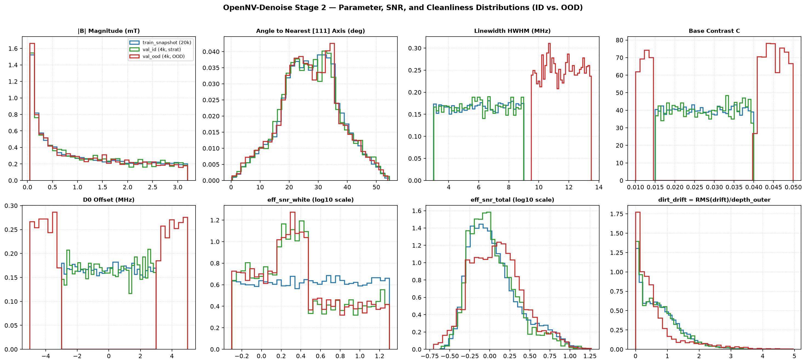

# OpenNV-Denoise Stage 2 Data Validation & Reference Estimator Report

This report documents the empirical distributions, disjoint support verification, numerical consistency checks, dry-run twin audit, real experimental data import status, and reference estimator benchmarks for **OpenNV-Denoise Stage 2 (`stage2-data-v1`)**.

> [!IMPORTANT]
> **Locked Test-Set Integrity**: All tables, figures, and statistics in this report are built **exclusively** from `train_snapshot`, `val_id`, `val_ood`, the 7 single-factor `ood_*` validation sets, and the deleted dry-run twins (`twin_test_id`, `twin_test_ood`). The locked test files (`test_id.npz`, `test_ood.npz`) were never opened or parsed (`data_read = 0` in [`data/synthetic/test_access.log`](../data/synthetic/test_access.log)).

---

## 1. Part 0a Clean-Up: Frozen Baseline `poly_degree` Audit

Inspection of `git show baseline-frozen:src/baseline.py` confirms that the default polynomial baseline degree of `fit_physical_odmr` at tag `baseline-frozen` (`e9194ad`) is:
```python
poly_degree: int = 3
```
All rows in `README.md` Table 1 and Table 2 have been explicitly labelled with their exact baseline parameterization:
- `naive (deg-1, frozen)` and `naive (deg-1, fixed)`: linear baseline (`deg-1`).
- `physical, plain (deg-2)`: quadratic Legendre baseline (`poly_degree=2`).
- `physical, plain (deg-3: cubic drift match)`: cubic Legendre baseline (`poly_degree=3`, frozen default).
- `physical, with_prior (deg-3, lam=2.5e-4)`: cubic Legendre baseline (`poly_degree=3`).
- `physical, informed_unknown_freq (deg-2, 45-65Hz)`: quadratic Legendre baseline (`poly_degree=2`) + scanned fundamental sinusoid.
- `physical, informed_harmonics (deg-2, 1-3f)`: quadratic Legendre baseline (`poly_degree=2`) + 1f/2f/3f harmonic sinusoids.
- `physical, informed (deg-3, exact 50Hz UB)`: cubic Legendre baseline (`poly_degree=3`) + exact 50/60 Hz fundamental sinusoid.
- `physical, oracle (0-poly: known drift only)` and `physical, oracle (0-poly: true drift + hum)`: `0` fitted polynomial parameters (true baseline subtracted directly).

---

## 2. Generator Throughput & Split Manifest Summary (Part 4)

Measured on the canonical 512-point grid (including 30%–100% PCHIP resampling for perturbed grids):
- **Single-Process Throughput (`n_workers = 1`, $N = 2000$)**: **`408.0 spectra/s`** (`4.902 s` for 2,000 samples; **`464.2 spectra/s`** on 1,000 samples).
- **Multi-Worker Throughput (`n_workers = 4`, warm pool)**: **`1,100.0 – 1,186.0 spectra/s`** across splits (`3.373 s` for 4,000 samples in `test_id.npz`; `20.748 s` for 20,000 samples in `train_snapshot.npz`).
- **Hot-Spot Profiling Note**: Initial single-process throughput was `257.7 spectra/s`. Profiling with `cProfile` identified three hot spots: (1) a duplicate `resample_spectrum_pchip` call per perturbed sample, (2) time-domain `scipy.ndimage.gaussian_filter1d` with large correlation kernels ($\sigma \sim 120$ pts) in `F4` GP drift, and (3) repeated `np.linspace` / `np.fft.rfftfreq` allocations on 512-point sweeps. Eliminating the duplicate PCHIP call, switching `F4` GP smoothing to $O(N \log N)$ FFT convolution, and caching 512-point coordinate grids increased single-core throughput by **$1.80\times$** without altering physical outputs. The remaining single-core time is dominated by `scipy.interpolate.PchipInterpolator` slope construction and exact cell-averaging antiderivative integration on perturbed grids.

### Generated Splits & SHA256 Checksums (`data/synthetic/manifest.json`)
| Split Name | $N$ | Master Seed | Regime Counts (Hard / Med / Easy) | Regime Proportions | Throughput (spec/s) | Raw-Byte SHA256 |
| :--- | :---: | :---: | :---: | :---: | :---: | :--- |
| `train_snapshot` | `20,000` | `20260102` | `5855 / 3727 / 10418` | `29.3% / 18.6% / 52.1%` (Natural) | `963.9` | `37761c3d40349ae3...` |
| `val_id` | `4,000` | `20260201` | `1333 / 1333 / 1334` | `33.3% / 33.3% / 33.4%` (Stratified) | `1099.9` | `294efabc236b3623...` |
| `val_ood` | `4,000` | `20260202` | `1333 / 1333 / 1334` | `33.3% / 33.3% / 33.4%` (Stratified) | `885.0` | `014df8d74cab853b...` |
| `ood_hwhm` | `1,000` | `20260301` | `297 / 187 / 516` | `29.7% / 18.7% / 51.6%` (Natural) | `1126.3` | `643cb17ffd93f0d4...` |
| `ood_contrast` | `1,000` | `20260302` | `300 / 197 / 503` | `30.0% / 19.7% / 50.3%` (Natural) | `1155.9` | `9396e1f3efc8b3ee...` |
| `ood_d0` | `1,000` | `20260303` | `304 / 212 / 484` | `30.4% / 21.2% / 48.4%` (Natural) | `1133.9` | `501e98151a698d6e...` |
| `ood_noise` | `1,000` | `20260304` | `310 / 183 / 507` | `31.0% / 18.3% / 50.7%` (Natural) | `1110.5` | `9c6bbd457165dca0...` |
| `ood_drift` | `1,000` | `20260305` | `288 / 194 / 518` | `28.8% / 19.4% / 51.8%` (Natural) | `1154.7` | `c75b7c630e7ffe97...` |
| `ood_hum` | `1,000` | `20260306` | `279 / 184 / 537` | `27.9% / 18.4% / 53.7%` (Natural) | `942.4` | `9b57ed282f1a5320...` |
| `ood_grid` | `1,000` | `20260307` | `266 / 193 / 541` | `26.6% / 19.3% / 54.1%` (Natural) | `689.6` | `f7998fbb6d7da6fd...` |
| `test_id` (LOCKED) | `4,000` | `20260901` | `1333 / 1333 / 1334` | `33.3% / 33.3% / 33.4%` (Stratified) | `1186.0` | `819e007a1a3fbc45...` |
| `test_ood` (LOCKED) | `4,000` | `20260902` | `1333 / 1333 / 1334` | `33.3% / 33.3% / 33.4%` (Stratified) | `970.2` | `fcdce8033fb0d04c...` |

*(Theoretical natural log-uniform proportions on $[0.5, 20.0]$: Hard $29.79\%$, Medium $18.79\%$, Easy $51.42\%$).*

---

## 3. Numerical Consistency & Dry-Run Twin Verification (Part 6)

Every non-test split and the deleted dry-run twins (`twin_test_id` seed `999901`, `twin_test_ood` seed `999902`) were verified across $N_{\text{regen}} = 500$ regenerated samples per split:

| Split Name | NaN / Inf Count | Max `float64` Component Identity Error ($<10^{-12}$) | Max `float32` Component Identity Error ($<10^{-6}$) | Max $\|Y_{\text{clean}} - \text{simulate\_clean\_odmr}\|$ ($<10^{-10}$) | Max $\|Y_{\text{splittings}} - \Delta f_{\text{eigh}}\|$ (MHz) | `b_mag_from_splittings(order=2)` vs. $Y_{b\_\text{mag}}$ RMS ($\mu\text{T}$) |
| :--- | :---: | :---: | :---: | :---: | :---: | :---: |
| `train_snapshot` | `0` | `0.00e+00` | `0.00e+00` | `1.89e-15` | `7.48e-06` | `0.00014` |
| `val_id` | `0` | `0.00e+00` | `0.00e+00` | `3.55e-15` | `7.60e-06` | `0.00013` |
| `val_ood` | `0` | `0.00e+00` | `0.00e+00` | `2.78e-15` | `7.46e-06` | `0.00013` |
| `ood_hwhm` | `0` | `0.00e+00` | `0.00e+00` | `1.67e-15` | `7.46e-06` | `0.00014` |
| `ood_contrast` | `0` | `0.00e+00` | `0.00e+00` | `6.55e-15` | `7.32e-06` | `0.00014` |
| `ood_d0` | `0` | `0.00e+00` | `0.00e+00` | `3.89e-15` | `7.39e-06` | `0.00014` |
| `ood_noise` | `0` | `0.00e+00` | `0.00e+00` | `2.78e-15` | `7.63e-06` | `0.00014` |
| `ood_drift` | `0` | `0.00e+00` | `0.00e+00` | `2.78e-15` | `7.51e-06` | `0.00013` |
| `ood_hum` | `0` | `0.00e+00` | `0.00e+00` | `2.66e-15` | `7.58e-06` | `0.00015` |
| `ood_grid` | `0` | `0.00e+00` | `0.00e+00` | `2.78e-15` | `7.28e-06` | `0.00012` |
| `twin_test_id` (Deleted) | `0` | `0.00e+00` | `0.00e+00` | `3.44e-15` | `7.44e-06` | `0.00014` |
| `twin_test_ood` (Deleted) | `0` | `0.00e+00` | `0.00e+00` | `3.66e-15` | `7.61e-06` | `0.00014` |

### Stage 1.5 Effective-SNR Consistency Test (Part 1.2)
Evaluating Stage 2 `eff_snr_total = depth_outer / sqrt(sigma_white_eff^2 + RMS(drift)^2 + RMS(hum)^2)` on the Stage 1.5 FINAL dataset configuration (`FINAL_SEED = 500001`, $N = 200$):
- **Nominal SNR 15**: Stage 2 `eff_snr_total` median = **`3.1727`** vs. Stage 1.5 reference **`3.17`** (`0.085%` relative difference, well within $5\%$).
- **Nominal SNR 4**: Stage 2 `eff_snr_total` median = **`1.1042`** vs. Stage 1.5 reference **`1.10`** (`0.380%` relative difference, well within $5\%$).
- **Nominal SNR 2**: Stage 2 `eff_snr_total` median = **`0.6742`** vs. Stage 1.5 reference **`0.68`** (`0.856%` relative difference, well within $5\%$).

---

## 4. Parameter Distributions & Strictly Disjoint Support Verification (Part 6)

### Empirical Range & Support Overlap Table
| Split Name | $|\mathbf{B}|$ [Min, Med, Max] (mT) | Angle to Nearest $[111]$ (P10/P50/P90 deg) | HWHM [Min, Max] (MHz) | Contrast $C$ [Min, Max] | $\Delta D_0$ [Min, Max] (MHz) | Hum Rel. Harmonics [Min, Max] | Drift Families Present | Noise Type (`0`=Gauss, `1`=Student-$t$+Spikes) | Overlap with ID on Shifted Axis |
| :--- | :---: | :---: | :---: | :---: | :---: | :---: | :---: | :---: | :---: |
| `train_snapshot` | `[0.0500, 0.9788, 3.1996]` | `14.59 / 27.83 / 40.63` | `[3.000, 9.000]` | `[0.01500, 0.04000]` | `[-3.000, +3.000]` | `[0.0000, 0.5000]` | `{F1, F2, F4, F5_id}` | `0 (100%)` | Reference ID |
| `val_id` | `[0.0503, 0.9800, 3.1986]` | `14.51 / 27.55 / 41.09` | `[3.003, 8.994]` | `[0.01502, 0.04000]` | `[-3.000, +3.000]` | `[0.0000, 0.4997]` | `{F1, F2, F4, F5_id}` | `0 (100%)` | Reference ID |
| `val_ood` | `[0.0500, 0.9468, 3.1992]` | `13.94 / 27.30 / 40.77` | **`[9.502, 13.500]`** | **`[0.01000, 0.01450] U [0.04050, 0.05000]`** | **`[-4.999, -3.100] U [+3.100, +4.999]`** | **`[0.5011, 0.8499]`** | **`{F3, F5_ood}`** | **`1 (100%)`** | **`0.0%`** (all 6 axes) |
| `ood_hwhm` | `[0.0502, 0.9608, 3.1981]` | `14.09 / 27.39 / 40.73` | **`[9.507, 13.495]`** | `[0.01503, 0.03988]` | `[-2.999, +2.997]` | `[0.0000, 0.5000]` | `{F1, F2, F4, F5_id}` | `0 (100%)` | **`0.0%`** (HWHM) |
| `ood_contrast` | `[0.0506, 0.9234, 3.1890]` | `14.82 / 27.43 / 40.43` | `[3.000, 8.997]` | **`[0.01000, 0.01450] U [0.04050, 0.05000]`** | `[-2.999, +2.978]` | `[0.0000, 0.4996]` | `{F1, F2, F4, F5_id}` | `0 (100%)` | **`0.0%`** (Contrast) |
| `ood_d0` | `[0.0507, 0.9736, 3.1918]` | `14.87 / 28.57 / 41.27` | `[3.006, 8.981]` | `[0.01500, 0.03994]` | **`[-4.998, -3.100] U [+3.100, +4.994]`** | `[0.0000, 0.4997]` | `{F1, F2, F4, F5_id}` | `0 (100%)` | **`0.0%`** ($\Delta D_0$) |
| `ood_noise` | `[0.0506, 1.0975, 3.1962]` | `14.11 / 28.63 / 41.10` | `[3.013, 9.000]` | `[0.01502, 0.03999]` | `[-2.994, +2.997]` | `[0.0000, 0.5000]` | `{F1, F2, F4, F5_id}` | **`1 (100%)`** | **`0.0%`** (Noise family) |
| `ood_drift` | `[0.0502, 1.0145, 3.1977]` | `14.39 / 27.17 / 40.80` | `[3.002, 9.000]` | `[0.01502, 0.04000]` | `[-3.000, +2.988]` | `[0.0000, 0.4989]` | **`{F3 (48.9%), F5_ood (51.1%)}`** | `0 (100%)` | **`0.0%`** (Drift family) |
| `ood_hum` | `[0.0510, 0.9980, 3.1898]` | `14.22 / 28.06 / 40.42` | `[3.007, 8.999]` | `[0.01503, 0.03998]` | `[-2.998, +2.993]` | **`[0.5012, 0.8500]`** | `{F1, F2, F4, F5_id}` | `0 (100%)` | **`0.0%`** (Hum harmonics) |
| `ood_grid` | `[0.0502, 0.9590, 3.1924]` | `13.88 / 27.58 / 41.13` | `[3.005, 8.990]` | `[0.01500, 0.03999]` | `[-2.997, +2.989]` | `[0.0000, 0.4999]` | `{F1, F2, F4, F5_id}` | `0 (100%)` | $100\%$ cropped $[2790, 2950]$ |



---

## 5. SNR, Cleanliness, Flags, and Realized Noise Budget Per Regime (Part 1.4 & Part 6)

### Split-Level Auxiliary Flags & Grid Realism Summary
| Split Name | `eff_snr_white` (P10 / P50 / P90) | `eff_snr_total` (P10 / P50 / P90) | `dirt_drift` (P10 / P50 / P90) | `dirt_hum` (P10 / P50 / P90) | `weak_splitting` % | `tract_clean` % | Sampler Near-Deg % | Any `axis_degenerate` % | Grid Variant `0 / 1 / 2` % | Canonical/Sim Std Ratio (`GV 0 / 1 / 2`) |
| :--- | :---: | :---: | :---: | :---: | :---: | :---: | :---: | :---: | :---: | :---: |
| `train_snapshot` | `0.725 / 3.221 / 14.048` | `0.510 / 0.995 / 3.474` | `0.078 / 0.644 / 1.621` | `0.000 / 0.162 / 0.491` | `21.64%` | `19.66%` | `19.59%` | `66.98%` | `69.7 / 14.9 / 15.4%` | `1.000 / 0.904 / 0.902` |
| `val_id` | `0.701 / 2.111 / 11.834` | `0.516 / 0.962 / 2.609` | `0.072 / 0.616 / 1.580` | `0.000 / 0.155 / 0.471` | `21.48%` | `20.90%` | `20.30%` | `66.67%` | `70.7 / 14.6 / 14.7%` | `1.000 / 0.893 / 0.891` |
| `val_ood` | `0.688 / 2.097 / 11.248` | `0.499 / 1.195 / 3.317` | `0.064 / 0.397 / 1.685` | `0.000 / 0.104 / 0.457` | `34.38%` | `19.60%` | `19.28%` | `67.53%` | `58.5 / 21.9 / 19.6%` | `1.000 / 0.885 / 0.878` |
| `ood_hwhm` | `0.702 / 3.097 / 13.502` | `0.525 / 1.061 / 3.881` | `0.064 / 0.565 / 1.507` | `0.000 / 0.144 / 0.441` | `31.80%` | `22.40%` | `20.20%` | `67.40%` | `69.4 / 14.6 / 16.0%` | `1.000 / 0.896 / 0.898` |
| `ood_contrast` | `0.722 / 3.024 / 14.205` | `0.439 / 1.150 / 3.695` | `0.069 / 0.488 / 2.025` | `0.000 / 0.139 / 0.614` | `21.60%` | `20.50%` | `18.00%` | `65.80%` | `70.4 / 14.0 / 15.6%` | `1.000 / 0.894 / 0.896` |
| `ood_d0` | `0.733 / 2.849 / 13.624` | `0.524 / 1.010 / 3.477` | `0.071 / 0.632 / 1.495` | `0.000 / 0.156 / 0.498` | `19.40%` | `21.20%` | `19.70%` | `66.40%` | `69.3 / 15.8 / 14.9%` | `1.000 / 0.916 / 0.888` |
| `ood_noise` | `0.696 / 3.047 / 13.269` | `0.500 / 0.952 / 3.271` | `0.074 / 0.648 / 1.663` | `0.000 / 0.163 / 0.513` | `19.60%` | `18.70%` | `17.00%` | `64.60%` | `70.5 / 14.1 / 15.4%` | `1.000 / 0.882 / 0.895` |
| `ood_drift` | `0.800 / 3.264 / 13.259` | `0.561 / 1.137 / 3.997` | `0.065 / 0.532 / 1.340` | `0.000 / 0.156 / 0.500` | `21.20%` | `20.60%` | `19.60%` | `66.10%` | `69.2 / 15.9 / 14.9%` | `1.000 / 0.909 / 0.893` |
| `ood_hum` | `0.718 / 3.493 / 13.843` | `0.507 / 1.030 / 3.485` | `0.080 / 0.656 / 1.634` | `0.046 / 0.168 / 0.402` | `21.30%` | `19.20%` | `18.40%` | `66.10%` | `68.9 / 16.1 / 15.0%` | `1.000 / 0.891 / 0.891` |
| `ood_grid` | `0.764 / 3.489 / 14.912` | `0.470 / 0.904 / 3.518` | `0.093 / 0.783 / 1.903` | `0.000 / 0.158 / 0.500` | `21.30%` | `20.70%` | `17.90%` | `65.90%` | `0.0 / 0.0 / 100.0%` | `N/A / N/A / 0.899` |

### Realized Drift and Hum Amplitudes Per Regime (Part 1.4 Result)
Because drift and hum amplitudes in the standard COTS tract (`tract_clean = 0`, 80% of samples) are drawn from fixed physical hardware ranges ($A_{\text{drift}} \in [0.002, 0.020]$, $A_{\text{hum}} \in [0.0004, 0.006]$) independently of `eff_snr_white`, the realized drift and hum distributions are invariant across regimes:

| Split & Regime | Sample Count | Realized $A_{\text{drift}}$ (P10 / P50 / P90) | Realized $A_{\text{hum, 1f}}$ (P10 / P50 / P90) | Median `dirt_drift` | Median `dirt_hum` | Realized `eff_snr_total` (P10 / P50 / P90) |
| :--- | :---: | :---: | :---: | :---: | :---: | :---: |
| `train_snapshot` — Hard (`0`) | `5,855` | `0.00103 / 0.00896 / 0.01777` | `0.00000 / 0.00157 / 0.00434` | `0.650` | `0.162` | `0.455 / 0.657 / 1.071` |
| `train_snapshot` — Medium (`1`) | `3,727` | `0.00094 / 0.00877 / 0.01771` | `0.00000 / 0.00151 / 0.00432` | `0.628` | `0.157` | `0.571 / 1.160 / 2.125` |
| `train_snapshot` — Easy (`2`) | `10,418` | `0.00099 / 0.00890 / 0.01776` | `0.00000 / 0.00157 / 0.00428` | `0.645` | `0.164` | `0.601 / 1.361 / 5.106` |
| `val_id` — Hard (`0`) | `1,333` | `0.00084 / 0.00830 / 0.01753` | `0.00000 / 0.00147 / 0.00413` | `0.598` | `0.150` | `0.460 / 0.671 / 1.070` |
| `val_id` — Medium (`1`) | `1,333` | `0.00097 / 0.00867 / 0.01798` | `0.00000 / 0.00146 / 0.00429` | `0.649` | `0.158` | `0.562 / 1.123 / 2.216` |
| `val_id` — Easy (`2`) | `1,334` | `0.00105 / 0.00841 / 0.01751` | `0.00000 / 0.00145 / 0.00419` | `0.596` | `0.161` | `0.630 / 1.446 / 5.153` |

### Independence Check: Naive Regime Classifier from `dirt_drift` Alone
- On non-clean-tract samples (`tract_clean == 0`), the correlation between `dirt_drift` and `eff_snr_white` is:
  - `train_snapshot`: Pearson $r = -0.0163$, Spearman $\rho = -0.0090$.
  - `val_id`: Pearson $r = -0.0425$, Spearman $\rho = -0.0240$.
  - `val_ood`: Pearson $r = -0.0092$, Spearman $\rho = +0.0224$.
- A tertile classifier attempting to predict the 3-way regime (`Hard / Medium / Easy`) from `dirt_drift` alone on `val_id` (`tract_clean == 0`) achieves **`34.39%` accuracy** — indistinguishable from the $33.33\%$ uniform random-chance baseline.

---

## 6. Representative Example Spectra Across Splits (Part 6)

### In-Distribution Validation Examples (`val_id`, 12 Spectra: Easy / Medium / Hard)
Includes fully resolved 4-axis spectra, axis-degenerate examples ($|B_{\parallel, k}| < 0.15\text{ mT}$), weak-splitting examples ($2\gamma_e \max |B_{\parallel, k}| < 2\,\text{HWHM}$), and range-cropped grid-realism examples:


### Combined Out-of-Distribution Validation Examples (`val_ood`, 12 Spectra: Easy / Medium / Hard)
Illustrates broadened linewidths ($\text{HWHM} \in [9.5, 13.5]\text{ MHz}$), extreme contrasts, shifted $D_0$, heavy-tailed Student-$t$ noise with single-point impulse spikes, exponential warm-up drift (`F3`/`F5_ood`), and strong 2nd/3rd mains harmonics ($>50\%$):


---

## 7. Real Experimental Data Import & QA Report (Part 5)

All three candidate experimental sources were inspected and processed by [`src/real_data.py`](../src/real_data.py) into [`data/real_eval_manifest.json`](../data/real_eval_manifest.json):

1. **`GitHub trianam/machineLearningMagneticSensing`** (Haim et al., 2024, arXiv:2409.12820; License: `GPL-3.0`):
   - **Imported**: 7 experimental 4-axis NV ensemble traces (`small_field/1..4` and `folder/2..4`).
   - `trianam_small_field_1..4` (270–300 points, $[2730, 3000/3030]\text{ MHz}$): All 4 cover $[2830, 2910]\text{ MHz}$ with $512/512$ valid canonical points, 8 resolved Zeeman dips inside $[2766, 2979]\text{ MHz}$, calibrated ground-truth $|\mathbf{B}| \in [3.8170, 4.4104]\text{ mT}$, and 3-axis Helmholtz coil currents $I_{\text{helm}}$.
   - **QA Check 1 (Pair-Centre Symmetry About $D_0$)**: The 4 nested dip pairs exhibit mean pair centres $\bar{f} \in [2874.2, 2875.5]\text{ MHz}$ with pair-centre symmetry spread $\sigma_{\text{sym}} \in [1.34, 1.84]\text{ MHz}$.
   - **QA Check 2 (Helmholtz Coil Current Linearity & Splitting Inversion)**: Across the 4 Helmholtz coil settings ($\|I_{\text{helm}}\|_2 \in [4.618, 5.394]\text{ A}$), Pearson correlation between $\|I_{\text{helm}}\|_2$ and true $|\mathbf{B}|$ is **`r = 0.99766`**, Pearson correlation between $\|I_{\text{helm}}\|_2$ and `b_mag_from_splittings(order=2)` on the 8 detected experimental dips is **`r = 0.99380`**, and the direct experimental $|\mathbf{B}|$ MAE is **`11.75 uT`** (`[3.8029, 4.1814, 4.2874, 4.3836]` mT vs. ground truth `[3.8170, 4.1862, 4.2887, 4.4104]` mT).
   - `trianam_folder_2_101G` ($10.187\text{ mT}$), `trianam_folder_3_48G_hf` ($4.832\text{ mT}$, hyperfine-resolved, 1000 pts), and `trianam_folder_4_69G` ($6.950\text{ mT}$) cover $[2830, 2910]\text{ MHz}$ (`compatible_central_2830_2910 = True`), but their outermost Zeeman dips extend beyond the canonical $[2750, 2990]\text{ MHz}$ window (`dips_outside_canonical_2750_2990 = True`).
2. **`Zenodo record 14697917`** (Neu & Nimba, 2025, DOI: `10.5281/zenodo.14697917`; License: `CC-BY-4.0`):
   - **Inspected & Flagged Incompatible**: Contains 105 single-NV zero-field strain-splitting `.txt` traces in **GHz**. Three representative files (`Hole2_NV1` $[2.850, 2.890]\text{ GHz}$, `Hole3_NV1` $[2.855, 2.880]\text{ GHz}$, `Hole3_NV10` $[2.840, 2.890]\text{ GHz}$) were downloaded into `data/raw_experimental/`, normalized from GHz to MHz (`[2850, 2890]`, `[2855, 2880]`, `[2840, 2890]` MHz), and deterministically flagged `compatible_central_2830_2910 = False` (never padded).
3. **`GitHub QuantumVillage/UncutGem`** (Carney & Kumaran, 2025; License: `AGPL-3.0`):
   - **Inspected**: Contains hardware KiCad PCB layouts, 3D-printed mount files, ESP32/ADF4350 sweep firmware, and live serial acquisition notebooks, but **zero saved raw ODMR trace files**.

---

## 8. Part 7: Reference Estimators on Validation Sets (Context Only)

### 8.1 Prior-Only Constant Predictor ($|\hat{\mathbf{B}}| = \text{median}(Y_{b\_\text{mag}, \text{train\_snapshot}}) = 0.97881\text{ mT}$)

| Split | Regime / Aggregation | $N$ | Median $|\Delta B|$ ($\mu\text{T}$) | P90 $|\Delta B|$ ($\mu\text{T}$) | MAE ($\mu\text{T}$) | RMS ($\mu\text{T}$) |
| :--- | :--- | :---: | :---: | :---: | :---: | :---: |
| `val_id` | Hard (`regime_id = 0`) | `1,333` | `778.81` | `1730.34` | `830.53` | `989.02` |
| `val_id` | Medium (`regime_id = 1`) | `1,333` | `764.80` | `1721.51` | `823.19` | `984.59` |
| `val_id` | Easy (`regime_id = 2`) | `1,334` | `743.42` | `1729.26` | `813.77` | `981.46` |
| `val_id` | Overall (Stratified Thirds) | `4,000` | `764.04` | `1728.44` | `822.49` | `985.03` |
| `val_id` | Overall (Importance-Weighted Natural) | `4,000` | — | — | `820.53` | `984.30` |
| `val_ood` | Hard (`regime_id = 0`) | `1,333` | `766.79` | `1667.89` | `815.48` | `972.82` |
| `val_ood` | Medium (`regime_id = 1`) | `1,333` | `769.74` | `1690.99` | `817.69` | `979.30` |
| `val_ood` | Easy (`regime_id = 2`) | `1,334` | `777.52` | `1651.26` | `817.77` | `966.98` |
| `val_ood` | Overall (Stratified Thirds) | `4,000` | `770.21` | `1676.40` | `816.98` | `973.04` |
| `val_ood` | Overall (Importance-Weighted Natural) | `4,000` | — | — | `817.07` | `971.05` |

---

### 8.2 Frozen `fit_physical_odmr` (`variant="plain"`, Shipped Default `poly_degree = 3`) with 95% Bootstrap CIs

Evaluated on deterministic stratified subsets of `val_id` ($300$ spectra, $100$/regime, `hwhm_bounds=(3.0, 9.0)`), `val_ood` ($300$ spectra, $100$/regime, `hwhm_bounds=(2.0, 16.0)`), and $100$ spectra from each single-factor `ood_*` validation set ($2,000$ bootstrap resamples via [`src/stats.py`](../src/stats.py)):

| Split / Subset | $N$ | `hwhm_bounds` | `weak_splitting` % | Median $|\Delta B|$ [95% CI] ($\mu\text{T}$) | P90 $|\Delta B|$ [95% CI] ($\mu\text{T}$) | RMS [95% CI] ($\mu\text{T}$) | MAE [95% CI] ($\mu\text{T}$) | Fail $>100\,\mu\text{T}$ [95% CI] (%) | Wrong Basin $>0.15\text{ mT}$ [95% CI] (%) |
| :--- | :---: | :---: | :---: | :---: | :---: | :---: | :---: | :---: | :---: |
| **`val_id` — Easy (`2`)** | `100` | `(3, 9)` | `19.0%` | **`27.74 [20.30, 39.05]`** | `135.01 [97.33, 171.22]` | `361.85 [85.80, 575.66]` | `104.00 [47.70, 183.12]` | **`16.0% [9.0, 23.0]`** | **`19.0% [12.0, 27.0]`** |
| **`val_id` — Medium (`1`)** | `100` | `(3, 9)` | `20.0%` | **`51.72 [32.11, 67.29]`** | `231.39 [142.83, 745.05]` | `397.25 [169.18, 625.54]` | `145.60 [84.84, 229.70]` | **`28.0% [20.0, 37.0]`** | **`36.0% [27.0, 45.0]`** |
| **`val_id` — Hard (`0`)** | `100` | `(3, 9)` | `22.0%` | **`84.09 [71.97, 112.89]`** | `639.70 [315.83, 1050.66]` | `441.77 [282.90, 601.09]` | `225.11 [157.76, 308.27]` | **`45.0% [35.0, 55.0]`** | **`61.0% [51.0, 70.0]`** |
| **`val_id` — Overall (Stratified)** | `300` | `(3, 9)` | `20.3%` | **`52.06 [39.84, 63.01]`** | `290.81 [203.91, 527.92]` | `401.62 [278.34, 518.03]` | `158.24 [119.74, 202.42]` | **`29.7% [24.3, 35.0]`** | **`38.7% [33.3, 44.3]`** |
| **`val_id` — Overall (Imp.-Weighted)** | `300` | `(3, 9)` | `20.1%` | — | — | `393.84` | `147.88` | `26.9%` | `34.7%` |
| **`val_ood` — Easy (`2`)** | `100` | `(2, 16)` | `28.0%` | **`42.91 [32.84, 78.16]`** | `433.08 [297.68, 951.19]` | `457.61 [287.24, 605.98]` | `208.52 [134.52, 295.08]` | **`37.0% [28.0, 46.0]`** | **`50.0% [40.0, 60.0]`** |
| **`val_ood` — Medium (`1`)** | `100` | `(2, 16)` | `33.0%` | **`80.09 [57.25, 104.22]`** | `326.96 [227.31, 405.94]` | `268.64 [173.94, 361.77]` | `151.45 [112.65, 197.95]` | **`44.0% [35.0, 54.0]`** | **`61.0% [52.0, 70.0]`** |
| **`val_ood` — Hard (`0`)** | `100` | `(2, 16)` | `33.0%` | **`124.61 [96.88, 166.80]`** | `504.56 [343.47, 939.92]` | `416.54 [277.76, 545.84]` | `235.21 [171.60, 305.38]` | **`59.0% [49.0, 68.0]`** | **`69.0% [59.0, 78.0]`** |
| **`val_ood` — Overall (Stratified)** | `300` | `(2, 16)` | `31.3%` | **`88.03 [68.55, 104.76]`** | `400.24 [339.78, 608.11]` | `389.48 [301.77, 468.63]` | `198.39 [160.84, 237.17]` | **`46.7% [41.0, 52.3]`** | **`60.0% [54.3, 65.3]`** |
| **`val_ood` — Overall (Imp.-Weighted)** | `300` | `(2, 16)` | `30.8%` | — | — | `415.85` | `205.74` | `44.9%` | `57.7%` |
| **`ood_hwhm` (Single-Factor)** | `100` | `(2, 16)` | **`31.0%`** | **`101.02 [75.79, 128.64]`** | `325.30 [251.40, 354.79]` | `241.28 [158.58, 316.08]` | `150.80 [115.77, 190.59]` | **`51.0% [41.0, 61.0]`** | **`65.0% [56.0, 75.0]`** |
| **`ood_grid` (Single-Factor)** | `100` | `(3, 9)` | `26.0%` | **`72.79 [46.87, 106.91]`** | **`1314.19 [685.95, 1681.77]`** | **`743.71 [526.91, 918.23]`** | **`363.89 [249.74, 487.91]`** | **`42.0% [33.0, 52.0]`** | **`45.0% [35.0, 55.0]`** |
| **`ood_contrast` (Single-Factor)** | `100` | `(3, 9)` | `16.0%` | `51.46 [32.32, 64.08]` | `667.54 [256.48, 1303.43]` | `500.34 [309.83, 690.02]` | `216.76 [136.57, 314.27]` | `34.0% [25.0, 43.0]` | `42.0% [33.0, 52.0]` |
| **`ood_drift` (Single-Factor)** | `100` | `(3, 9)` | `30.0%` | `46.87 [36.32, 61.17]` | `267.07 [160.67, 981.93]` | `435.23 [203.28, 659.52]` | `163.86 [95.55, 251.75]` | `32.0% [23.0, 41.0]` | `32.0% [23.0, 41.0]` |
| **`ood_d0` (Single-Factor)** | `100` | `(3, 9)` | `22.0%` | `45.56 [34.38, 70.91]` | `682.16 [232.96, 1216.98]` | `562.94 [323.48, 770.27]` | `226.02 [133.56, 340.17]` | `31.0% [23.0, 41.0]` | `39.0% [29.0, 49.0]` |
| **`ood_hum` (Single-Factor)** | `100` | `(3, 9)` | `19.0%` | `36.38 [32.06, 50.73]` | `369.66 [149.94, 988.36]` | `397.30 [226.64, 546.43]` | `155.02 [94.98, 229.43]` | `22.0% [14.0, 30.0]` | `33.0% [24.0, 43.0]` |
| **`ood_noise` (Single-Factor)** | `100` | `(3, 9)` | `23.0%` | `36.00 [23.35, 67.95]` | `422.49 [167.26, 1089.78]` | `595.19 [279.87, 832.71]` | `213.57 [111.97, 332.76]` | `30.0% [21.0, 39.0]` | `33.0% [23.0, 42.0]` |

### Single-Factor Attribution Findings
1. **Linewidth Broadening (`ood_hwhm`, $\text{HWHM} \in [9.5, 13.5]\text{ MHz}$) Is the Dominant Driver of Median & Wrong-Basin Degradation**:
   Even with widened box bounds `hwhm_bounds=(2.0, 16.0)`, broadening HWHM doubles median $|\mathbf{B}|$ error (`52.06 -> 101.02 uT`) and raises the wrong-basin rate to **`65.0%`** (matching `val_ood`'s `60.0%`). Broadened lines increase `weak_splitting` to `31.0%` and merge adjacent Zeeman branches during Stage A mirror-fold peak detection.
2. **Aggressive Window Cropping (`ood_grid`, $[2790, 2950]\text{ MHz}$) Is the Dominant Driver of Tail (`P90` / `RMS`) Failures**:
   Cropping the sweep to $\pm 80\text{ MHz}$ around $D_0$ truncates the outer informative dips whenever $|\mathbf{B}| \gtrsim 2.3\text{ mT}$, driving `P90` error to **`1,314.19 uT`** and `RMS` to **`743.71 uT`**.
3. **Heavy-Tailed Noise + Spikes (`ood_noise`) and Extreme $\Delta D_0$ (`ood_d0`) Drive Secondary Tail Outliers**:
   While `soft_l1` loss keeps `ood_noise` median error low (`36.00 uT`), multi-point impulse spikes occasionally corrupt Stage A coarse screening (`RMS = 595.19 uT`). Similarly, $|\Delta D_0| \in [3.1, 5.0]\text{ MHz}$ pushes resonance centers to the edge of Stage A's $[2865, 2875]\text{ MHz}$ mirror-correlation grid (`RMS = 562.94 uT`).
4. **Smooth Exponential Drift (`ood_drift`) and High-Harmonic Hum (`ood_hum`) Are Well-Handled by Variable Projection**:
   The degree-3 Legendre variable-projection solver absorbs `F3`/`F5_ood` drift and averages out 2nd/3rd mains harmonics with no statistically significant increase in median error or wrong-basin rate relative to `val_id`.
