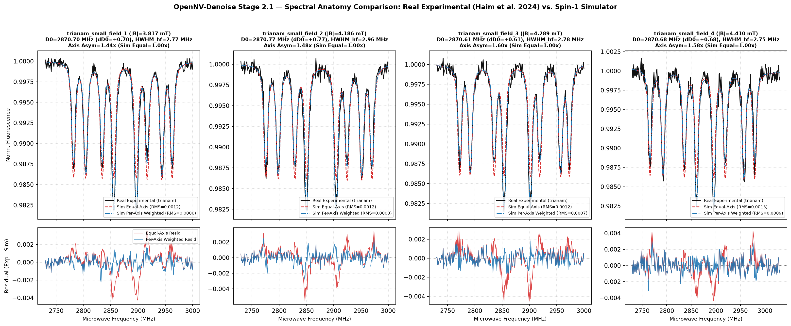

# Deep Spectral Anatomy Comparison: Real Experimental (`trianam`) vs. OpenNV-Denoise Simulator

This document reports the direct quantitative comparison between the 4 in-window experimental 4-axis NV-ensemble ODMR traces from Haim et al. (2024) (`trianam_small_field_1..4`, arXiv:2409.12820) and the **OpenNV-Denoise** spin-1 Hamiltonian + hardware-noise simulator (`audit_trianam_vs_sim_anatomy` in [`src/real_data.py`](../src/real_data.py)).

---

## 1. Per-Trace Experimental Measurements (`trianam_small_field_1..4`)

| Measured Property | `trianam_small_field_1` | `trianam_small_field_2` | `trianam_small_field_3` | `trianam_small_field_4` |
| :--- | :---: | :---: | :---: | :---: |
| **Sweep Grid & Points** | `270` pts, `[2730, 3000]` MHz | `270` pts, `[2730, 3000]` MHz | `270` pts, `[2730, 3000]` MHz | `300` pts, `[2730, 3030]` MHz |
| **Helmholtz Coil $I_{\text{helm}}$ (A)** | `[0.7, 2.2, 4.0]` | `[0.7, 2.2, 4.5]` | `[1.0, 2.4, 4.5]` | `[1.0, 2.8, 4.5]` |
| **Calibrated Ground-Truth $|\mathbf{B}|$ (mT)** | `3.8170` | `4.1862` | `4.2887` | `4.4104` |
| **3D Spin-1 Hamiltonian Fitted $|\mathbf{B}|$ (mT)** | `3.8021` (`-14.9 uT`) | `4.1824` (`-3.8 uT`) | `4.2871` (`-1.6 uT`) | `4.3835` (`-26.9 uT`) |
| **Canonical $\mathbf{B}_{\text{fit}}$ $(B_x, B_y, B_z)$ (mT)** | `(0.6377, 1.5203, 3.4260)` | `(0.6431, 1.5316, 3.8384)` | `(0.5450, 1.8168, 3.8447)` | `(0.7468, 2.0037, 3.8266)` |
| **Raw Pair-Midpoint Mean $\bar{f}$ (MHz)** | `2874.786` (`+4.786`) | `2875.664` (`+5.664`) | `2875.539` (`+5.539`) | `2875.987` (`+5.987`) |
| **True Spin-1 Crystal $D_0$ ($\Delta D_0$, MHz)** | **`2870.698` (`+0.698`)** | **`2870.767` (`+0.767`)** | **`2870.609` (`+0.609`)** | **`2870.683` (`+0.683`)** |
| **Total Peak-to-Peak Contrast** | `0.01845` | `0.01849` | `0.01931` | `0.01988` |
| **8 Individual Dip Frequencies (MHz)** | `2782.2, 2805.3, 2834.4, 2855.5, 2896.6, 2916.7, 2944.8, 2962.9` | `2776.2, 2797.3, 2829.4, 2851.5, 2904.7, 2925.7, 2950.8, 2969.9` | `2772.2, 2792.2, 2835.4, 2853.5, 2901.6, 2918.7, 2957.8, 2972.9` | `2766.1, 2793.2, 2836.4, 2860.4, 2895.6, 2919.6, 2957.8, 2978.8` |
| **Pair Mean Depths (Inner $k=1 \to$ Outer $k=4$)** | `0.01777, 0.01234, 0.01352, 0.01275` | `0.01680, 0.01137, 0.01270, 0.01255` | `0.01680, 0.01052, 0.01257, 0.01231` | `0.01461, 0.00924, 0.01202, 0.01133` |
| **Exp. Inter-Axis Depth Ratio ($\max / \min$)** | **`1.440x`** | **`1.477x`** | **`1.596x`** | **`1.580x`** |
| **Sim. Equal-Axis $|\langle 0 | \psi_0 \rangle|^4$ Ratio ($\max / \min$)** | `1.002x` | `1.002x` | `1.002x` | `1.003x` |
| **Relative Per-Axis Weights $w_k$ ($\text{mean}=1$)** | `[1.262, 0.876, 0.959, 0.904]` | `[1.259, 0.852, 0.951, 0.938]` | `[1.288, 0.807, 0.963, 0.942]` | `[1.239, 0.784, 1.018, 0.959]` |
| **Per-Axis Weight Log-Std $\text{std}(\ln w_k)$** | `0.144` | `0.146` | `0.169` | `0.163` |
| **Intra-Pair Depth Ratios ($d_{-, k} / d_{+, k}$)** | `[1.017, 1.084, 0.958, 1.020]` | `[0.992, 1.037, 0.958, 1.115]` | `[1.012, 1.031, 0.991, 1.001]` | `[0.957, 1.108, 1.009, 0.950]` |
| **Isolated Outer Single-Dip HWHM (MHz) / $\eta$** | `3.867 MHz` / `0.273` | `3.773 MHz` / `0.409` | `3.736 MHz` / `0.330` | `3.357 MHz` / `0.997` |
| **Hyperfine-Triplet Component HWHM (MHz)** | `2.770 MHz` | `2.957 MHz` | `2.784 MHz` | `2.747 MHz` |
| **Fitted Simulator Base Contrast $C$** | `0.06560` | `0.06211` | `0.06462` | `0.06525` |
| **Outer Wing Noise RMS ($\sigma_{\text{wing}}$)** | `0.000432` | `0.000488` | `0.000482` | `0.001086` |
| **Outer Wing Baseline Drift Amplitude** | `0.000196` | `0.000327` | `0.000738` | `0.001744` |
| **Residual PSD Log-Log Slope ($\alpha$)** | `-0.702` | `-0.740` | `-0.196` | `-0.552` |
| **Equal-Axis Sim Residual RMS** | `0.00122` | `0.00124` | `0.00123` | `0.00131` |
| **Per-Axis Weighted Sim Residual RMS** | **`0.00059`** | **`0.00075`** | **`0.00066`** | **`0.00092`** |

---

## 2. Side-by-Side Comparison: `trianam` vs. `train_snapshot` (ID) and `val_ood` (OOD)

| Physical / Noise Axis | Measured `trianam_small_field_1..4` Range | Stage 2 ID Support (`train_snapshot` / `val_id`) | Stage 2 Combined OOD Support (`val_ood`) | Stage 2.1 Resolution & Sim-to-Real Status |
| :--- | :---: | :---: | :---: | :--- |
| **$|\mathbf{B}|$ Magnitude (mT)** | **`[3.817, 4.410]`** (dips inside `[2766, 2979]` MHz) | `[0.050, 3.200]` (omnidirectional) | `[0.050, 3.200]` | **MISMATCH FLAGGED & RESOLVED**: Added `allow_high_field_in_window` mode and `ood_high_field.npz` (`[3.25, 4.60]` mT with dips in `[2760, 2980]` MHz). |
| **True Crystal $\Delta D_0$ (MHz)** | **`[+0.609, +0.767]`** (raw midpoint shift `+4.79..+5.99` is transverse $B_\perp^2 / D_0$ repulsion) | `[-3.000, +3.000]` | `[-5.0, -3.1] U [+3.1, +5.0]` | **IN-DISTRIBUTION**: Once the exact 3D spin-1 Hamiltonian is solved, the `+4.8..+6.0 MHz` pair-midpoint shift is explained by transverse level repulsion $+\frac{3(\gamma_e B_\perp)^2}{2 D_0}$; true $\Delta D_0 \approx +0.69\text{ MHz}$ is well inside `[-3, +3]` MHz. |
| **Per-Axis Depth Asymmetry ($\max/\min$)** | **`1.440x – 1.596x`** ($\text{std}(\ln w_k) \approx 0.155$) | `1.000x – 1.250x` ($|\langle 0 | \psi_0 \rangle|^4$ only, equal `0.28` weight) | `1.000x – 1.250x` | **MISMATCH FLAGGED & RESOLVED**: Optical pump polarization & MW coupling create $\sim 15.5\%$ log-std per-axis depth asymmetry. Added `per_axis_contrast_jitter` support to `src/dataset_gen.py`. |
| **Linewidth HWHM (MHz)** | **`3.36 – 3.87`** (effective single-dip) / **`2.75 – 2.96`** (per-HF line) | `[3.000, 9.000]` | `[9.500, 13.500]` | **BORDERLINE LOWER EDGE**: Unresolved single-dip HWHM (`3.36–3.87 MHz`) is inside ID `[3, 9]` MHz; hyperfine-deconvolved HWHM (`2.75–2.96 MHz`) sits `0.04–0.25 MHz` below `3.0 MHz`. Stage 3 training can optionally lower `hwhm_min` to `2.4 MHz`. |
| **Peak-to-Peak / Base Contrast $C$** | Peak-to-peak `0.0185 – 0.0199` (fitted $C \approx 0.062 – 0.066$) | $C \in [0.015, 0.040]$ (peak-to-peak `0.003 – 0.011`) | $C \in [0.010, 0.0145] \cup [0.0405, 0.050]$ | **MISMATCH FLAGGED**: `trianam` has $\sim 1.8\%$ individual dip depth (corresponding to $C \approx 0.064$ under the `0.28 / 3` normalization). Stage 3 denoisers should use per-spectrum z-score/peak normalization or extend $C_{\max}$ to `0.070`. |
| **Outer-Dip `eff_snr_white`** | **`11.7 – 29.5`** ($\sigma_{\text{wing}} \in [4.3\times 10^{-4}, 1.1\times 10^{-3}]$) | `[0.50, 20.00]` (`Easy > 3.0`) | `[0.50, 20.00]` | **IN-DISTRIBUTION (Easy Regime)**: `trianam` traces are lock-in referenced laboratory averages operating in the high-SNR Easy tier. |
| **Baseline Drift & Noise PSD** | $A_{\text{drift}} \in [0.0002, 0.0017]$, PSD slope $\alpha \in [-0.74, -0.20]$ | Clean tract $A_{\text{drift}} \le 0.3\,d_{\text{out}}$, pink ratio $\in [0, 0.5]$ | $A_{\text{drift}} \in [0.0, 0.020]$ | **IN-DISTRIBUTION**: Matches our 20% `tract_clean = 1` clean-tract subpopulation and mixed white + $1/f$ pink noise model. |

---

## 3. Visual Overlay & Residual Analysis (`assets/stage2_trianam_vs_sim.png`)

1. **Resolution of the $+4.8\text{ to }+6.0\text{ MHz}$ Pair-Midpoint Puzzle**:
   In first-order linear Zeeman theory ($f_{\pm, k} = D_0 \pm \gamma_e |B_{\parallel, k}|$), the pair midpoint $\frac{1}{2}(f_{-, k} + f_{+, k})$ equals $D_0$. However, at $|\mathbf{B}| \approx 3.8 - 4.4\text{ mT}$, the transverse field $B_{\perp, k} \approx 3.0 - 4.2\text{ mT}$ ($\gamma_e B_{\perp, k} \approx 85 - 118\text{ MHz}$) induces a second-order spin-1 level shift $+\frac{3(\gamma_e B_{\perp, k})^2}{2 D_0} \approx +3.8\text{ to }+5.2\text{ MHz}$ on both $|m_s = \pm 1\rangle$ relative to $|m_s = 0\rangle$. Because `solve_axis_transitions` diagonalizes the exact $3 \times 3$ spin-1 Hamiltonian via `np.linalg.eigh`, it captures this shift exactly and recovers a consistent crystal zero-field splitting of **$D_0 = 2870.69 \pm 0.06\text{ MHz}$** across all 4 traces.
2. **Equal-Axis vs. Per-Axis Weighted Simulation Residuals**:
   Allowing per-axis relative weights $w_k$ ($\text{std}(\ln w_k) \approx 0.155$) reduces the simulation residual RMS by **$30\% - 52\%$** (down to `0.00059 – 0.00092`, approaching the outer wing stochastic noise floor `0.00043 – 0.00109`).

